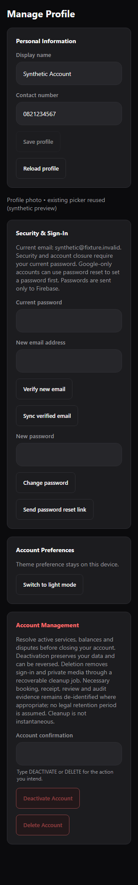
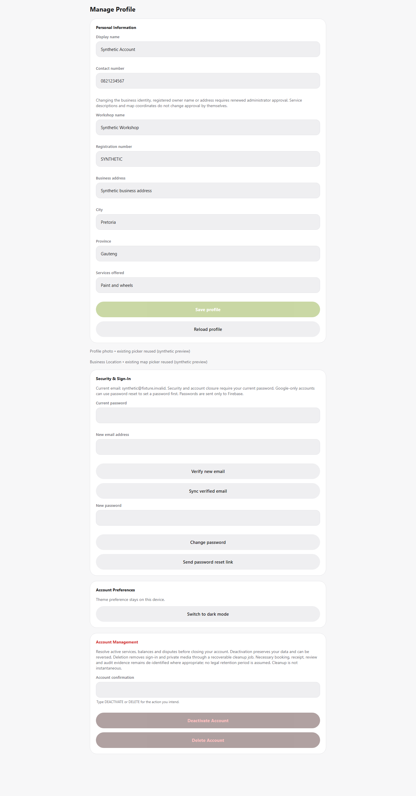

# Booking workflow and self-service account management

Implementation and local verification: 29 October 2026. No production customer records were accessed or modified. No commit, push or deployment was performed. The master academic DOCX is unchanged.

Sign In UI follow-up: [Clean Sign In and contextual self-reactivation](SIGN_IN_SIMPLIFICATION.md). The normal account-status panel has been removed. Eligible self-deactivated customers/workshops are offered optional recovery only after an actual verified email/password sign-in and backend status check. Pending-deletion users are directed to support; underlying authenticated status functionality remains.

Production safety follow-up: [Account deletion production safety review](ACCOUNT_DELETION_PRODUCTION_SAFETY.md). Permanent-deletion intake (`PMR_ACCOUNT_DELETION_REQUESTS_ENABLED`) and execution (`PMR_ACCOUNT_DELETION_WORKER_ENABLED`) now require independent exact `true` opt-ins; both default disabled. This supersedes any unconditional deletion-execution description below. Deactivation recovery remains active. Deploy the additional `accountLifecycleJobs(state, kind, dueAt)` index before rollout.

## Findings and corrected booking behavior

Cancellation previously depended on booking status alone. Service completion deliberately leaves the booking `confirmed`, so both the customer form and direct cancellation API still allowed cancellation. Both roles now reject cancellation if `serviceStatus` is `completed` **or** completion evidence exists. The existing completed state, booking history and payment accounting remain separate; completing an unpaid simulated booking does not settle its balance.

Completion previously lacked an appointment-time guard. The server now rejects future saved timestamps and future typed appointment values, interpreted in SAST (`+02:00`). Malformed scheduling evidence requires reconciliation. The UI provides the same explanation and disables completion. Elapsed appointments and confirmed legacy bookings with no appointment fields retain their existing workflow. No stored dates or historical timestamps are rewritten.

Review fetching previously refreshed for identity, booking ID and focus, but ignored changing completion evidence and manual booking refresh. Eligibility reads also omitted the workshop availability check used by submission, and returned no specific unavailability reason. The existing component now refreshes on completion evidence/status changes, manual refresh and focus, shows loading/error/retry states, and displays the server's reason. A saved review exposes “View Your Review”; eligible unreviewed customers see “Rate & Review Workshop.” Submission, ownership checks, moderation and duplicate prevention remain in the existing system.

Eligibility still requires the authenticated active customer to own a confirmed, non-cancelled, non-invalidated completed booking with a valid server completion timestamp and an available approved workshop. Payment settlement is not a review requirement. Missing timestamps are reported for workshop/support reconciliation, never fabricated or backfilled. The production record behind the reported missing review button was **not inspected**; stale refresh behavior is reproducible, but a production-specific missing timestamp/profile restriction cannot be confirmed from local evidence.

The completion transaction now creates one customer notification at `notifications/service_complete_{bookingId}`, titled “Your service is complete!”, with sanitized workshop/service text, `readAt: null` and the existing `{type: 'booking', id}` destination. Existing notification list/count/read authorization handles it. Transactional mutation receipts and the deterministic notification ID prevent duplicate invitations. Invalid completion writes create none. The workshop's existing review-submitted notification remains separate. No push provider or email delivery was enabled.

## Existing account features reused

The existing Firebase Auth session, isolated sign-in/recovery session, AuthContext, profile cache, API client, mutation receipts, audit logs, theme preference, profile-photo picker, workshop location picker, confirmation dialogs and admin identity confirmation are reused. Customer account summaries and workshop account/status/document screens remain available. Previously, normal users had no complete shared profile editor or self-service closure/recovery workflow; administrator suspension/archival was a separate existing mechanism.

Customer Profile → Manage Profile and Workshop Account → Manage Profile now open one shared editor with:

1. **Personal Information:** validated display name/contact number, existing photo controls, permitted workshop business/service fields and existing map location controls.
2. **Security & Sign-In:** current-password reauthentication, Firebase `verifyBeforeUpdateEmail`, synchronization from verified Firebase email, password change and reset link.
3. **Account Preferences:** existing device theme preference.
4. **Account Management:** separate danger actions, exact typed `DEACTIVATE`/`DELETE`, current password and a final confirmation dialog.

Profile updates whitelist fields and use an optimistic profile version plus a stable retry key. Roles, approval, ratings, evidence, account status and arbitrary coordinates cannot be supplied through ordinary profile saving. Workshop name, registration, registered owner/display name or postal address/city/province changes set verification back to pending. Services and the existing coordinate editor do not themselves change identity approval. Coordinates and existing rating totals are preserved when saving business fields.

Email and password operations use Firebase's existing SDK. Passwords never enter the account API. The new email is not applied by an ordinary profile update; destination verification happens first. Password change signs out and clears cached profile data. Google-only users can use the existing Firebase password-reset path to establish a password before password-based confirmation; Google sign-in itself is unchanged. Actual email delivery and hosted action-link configuration require environment acceptance testing.

Disabled/offline controls, synchronous action locks, child upload locks and UID-keyed drafts prevent duplicate actions and cross-account draft reuse. Late API acknowledgements after a Firebase identity change are rejected. No dependencies were added.

## API and authorization

`POST /api/account` uses the existing verified Firebase authentication middleware and request policy. Owner identity always comes from the verified token; a client UID, role, password or arbitrary email is rejected.

| Operation | Accepted payload beyond `op` | Behavior |
| --- | --- | --- |
| `profile` | None | Read permitted self fields, current version and Firebase email |
| `save` | `fullName`, `phone`, workshop `shop`, `version`, `requestId` | Transactional whitelist/versioned update and audit |
| `syncEmail` | `requestId` | Recent auth; email derived from verified live Firebase identity |
| `deactivate` / `delete` | `confirmation`, `requestId` | Recent auth, obligations check, durable restriction/job |
| `status` | None | Minimal own account/job state, including pending cleanup issue |
| `reactivate` | `requestId` | Recent auth; only a completed self-deactivation |

Sensitive self-service operations require authentication within five minutes. Live Firebase account state, verified email, current Firestore role/status and operation locks are checked. Ordinary self-service excludes administrators. Admin lifecycle continuation uses the existing admin endpoint's `accountLifecycleResume`, verified admin claims/profile and recent identity confirmation; ordinary users cannot invoke it for another UID.

Only the explicit status/reactivation path accepts a verified self-deactivated/deleting identity. Other APIs retain active-account authorization. Recovery signs in through the existing isolated Firebase session and never promotes that session into the application. Admin suspension/archival and deletion cannot be bypassed through self-reactivation.

New lifecycle jobs are server-only in Firestore rules. Upload ledgers remain denied by the existing default-deny rules. Direct client access is tested for customer, workshop and admin identities; admins operate through the backend.

## Closure policy and recoverable lifecycle

Both closure actions fail closed if any owned/assigned booking has an active service, unknown/nonzero completed balance, unresolved reconciliation, or an active/unresolved dispute. Cancelled bookings are permitted only without unresolved reconciliation/dispute flags. Simulated amounts are not silently forgiven. More than 200 associated bookings require support review instead of an unbounded transaction. A protected operator closure hold also blocks closure. Resolution must follow the existing booking/payment/dispute process; this feature introduces no settlement override.

Deactivation atomically restricts the profile before revoking refresh tokens. It keeps the Firebase identity enabled solely so authenticated isolated recovery can work; server-side account status denies marketplace activity. Approved-workshop discovery excludes deactivated workshops. The completed self-deactivation can be reversed by its owner after fresh authentication; historical records and verification status remain intact. A revocation failure leaves the account restricted with a pending job.

Deletion immediately changes status to `deleting`, revokes refresh tokens and signs out locally. The response says accepted/pending, never “deleted successfully.” Its durable `accountLifecycleJobs/{uid}` advances through:

`revoke → settle → bounded media scans → bounded data cleanup → Firebase Auth deletion → minimal profile tombstone → completed`

The backend's existing server starts a one-minute worker, examining up to three due jobs. Each invocation advances one bounded phase/page, with a two-minute lease to prevent concurrent workers. Data pages contain at most 20 documents. Media removal uses at most 20 objects per call and requires a later empty namespace scan before advancing. Restarts resume from the saved phase/cursor; failed operations record a generic issue and remain pending. There is no fixed completion-time promise, especially while the hosting service sleeps or storage is unavailable. An administrator can resume a job from account details. Admin details remain readable if Auth deletion succeeded but its acknowledgement was lost; retry tolerates `auth/user-not-found` and finishes the tombstone transaction.

The settle stage waits at least two minutes and stops for unresolved `uploading` ledgers. New showcase uploads now reserve a ledger before I/O and recheck eligibility afterwards. Document upload reservation now transactionally checks current account eligibility before I/O as well. Existing vehicle/request/profile upload reservations already perform current-profile checks. Presence updates check the live account in their transaction. These changes prevent late activity from recreating owned records after restriction.

## Retention and storage treatment

This is an operational minimization policy, **not a legal retention-period determination**. Retained identifiers are pseudonymous linkage, not a guarantee of irreversible anonymization. Final tombstones carry `retentionReviewRequired: true` so the operator can review lawful business retention separately. No automatic time-based historical erasure is introduced.

| Data | Deletion treatment / purpose retained |
| --- | --- |
| Firebase identity and personal profile | Auth deleted last; personal profile replaced with a minimal deleted-role tombstone |
| Bookmarks and owned vehicles | Removed; other users' records untouched |
| Verification documents, profile photos, vehicle/request media and showcase images | Remove via Storage API from validated owned namespaces in configured current and legacy buckets |
| Upload ledgers and photo metadata | Removed only after namespace cleanup; unknown provider/bucket/path pauses the job and preserves references for reconciliation |
| Showcase posts | Minimal removed-content tombstone with empty media/body, never eligible for feed/Saved Posts |
| Service requests | Minimal closed historical parent with booking linkage; detailed text/media removed |
| Quotations | Accepted contractual evidence retained; other quotes authored by the deleting workshop and its quotation heads removed |
| Bookings and receipts | Financial/service evidence and linkage retained; deleting customer's display identity replaced; provider behavior and amounts unchanged |
| Messages and conversations | Deleting participant's message text and own enquiry/identity previews redacted; ordering/read counters and the other party's messages preserved |
| Service reviews | Genuine reviews/moderation evidence retained; deleted workshop rating totals/history archived; new reviews disallowed; admin moderation/reconciliation still work |
| Notifications/presence | Owned notification inbox and presence removed |
| Email records | Owned test sink removed; owned delivery-job content replaced by minimal cancelled metadata; integration/configuration unchanged |
| Audit/mutation/lifecycle evidence | Security operation records and linkage retained; self-authored audit detail minimized; admin moderation reasons retained |

Configured namespace sweeps also find unreferenced objects without a Firestore asset row. Ownership/path validation never authorizes deleting a foreign prefix or unknown bucket. Bucket listing/removal errors, unexpected folder structures, malformed metadata and unresolved uploads leave cleanup pending. Operators must establish the actual upload/storage outcome before reconciliation; repeatedly pressing Resume cannot safely resolve unknown ownership. Storage deletion uses the existing service-side client, not SQL against `storage.objects`. The approach follows Supabase's [listing](https://supabase.com/docs/reference/javascript/storage-from-list) and [removal](https://supabase.com/docs/reference/javascript/storage-from-remove) APIs.

Limits: these local checks do not inventory unknown historical external buckets/providers, third-party copies, backups, downloaded files or public CDN/browser caches. Such resources require a separate authorized operator inventory/retention process. Existing private signed links may remain valid until expiry. No claim is made that every historical external copy can be erased.

## Verification and screenshot evidence

All writes used memory mocks or Firebase Auth/Firestore emulators with `demo-pmr-security`. Storage namespace/pagination/failure tests use a mocked Supabase client; emulator lifecycle tests use a deterministic storage adapter. No live storage deletion was performed.

| Check | Result |
| --- | --- |
| Focused backend/UI/account/admin/navigation run | 207 passed, 0 failed (`.local-checks/account-booking-final-tests.log`) |
| Expanded Auth/Firestore/rules run | 30 passed, 0 failed (`.local-checks/account-booking-emulators-final.log`) |
| Final account/worker emulator run | 9 passed, 0 failed, including concurrent closure, scheduled-worker lease recovery and unknown document/showcase references (`.local-checks/account-worker-emulators.log`) |
| Archived-review moderation/reconciliation run | 12 passed, 0 failed (`.local-checks/account-review-archive-final.log`) |
| Document upload reservation/failure checks | 8 passed, 0 failed; also included in focused run |
| Preservation regression run | 161 passed; one stale notification-header assertion expected two actions despite the existing Studio action. Corrected only that assertion; notification tests then passed in the 207-test run |
| Production web export | Passed, including API URL/environment/export verifier; network requests in that verifier are mocked |
| Android Hermes export | Passed; bundle compilation is not a physical-device interaction test |
| Synthetic layout captures | 320 px Customer and completed-booking content, 1440 px Workshop; no horizontal overflow; profile sections and disabled closure controls checked |

Representative focused command:

```powershell
node --test --test-concurrency=2 backend/test/account-management.test.cjs backend/test/documents.test.cjs backend/test/storage.test.cjs backend/test/marketplace.test.cjs tests/bookings-ui.test.cjs tests/service-reviews-ui.test.cjs tests/account-management.test.cjs tests/account-management-ui.test.cjs tests/notifications-navigation.test.cjs tests/admin-validation.test.cjs tests/admin-dashboard.test.cjs tests/admin-api.test.cjs
```

Emulators execute `backend/test/account-management-integration.test.cjs`, `backend/test/service-reviews-integration.test.cjs` and `tests/rules/access.test.cjs`, sequentially, through `firebase emulators:exec --only auth,firestore --project demo-pmr-security`. `scripts/test-emulators.cjs` now includes the account integration file for subsequent full security runs. Builds: `npm.cmd run build:web` and `node node_modules/expo/bin/cli export --platform android --max-workers 2 --output-dir .local-checks/account-booking-android`.

Tests cover: both-role completed cancellation, direct API rejection, future/legacy completion, unchanged unpaid balances, one invitation, review submission/existing review/unavailability/focus/manual refresh, profile whitelists/versions, Firebase email/password boundaries, duplicate taps/network failures, UID replacement, deactivation/recovery, workshop discovery restrictions, unresolved obligations, cross-account isolation, unknown media and in-flight upload holds, partial-storage failure, lost Auth-deletion acknowledgement, retained reviews, concurrent closure, scheduled-worker lease recovery and Firestore rule denial. The final nine-test account run repeats the eight account cases in the 30-test run and adds the concurrency/worker case; these counts are not additive unique-test totals.

The in-app browser was unavailable; installed headless Chrome captured these **synthetic component previews**, not a live authenticated application session. Profile photo/location controls are explicitly substituted with labeled placeholders in the previews; their existing controls have separate regression coverage. Icon/font rendering uses preview stubs. Functional interactions use the UI tests. Android hardware, keyboard/autofill, actual Firebase email action links and live Supabase permissions remain manual acceptance items.






## Deployment order, rollback and review readiness

1. Review retention/minimization rules, support ownership and pending-job handling with the project operator. Confirm configured current/legacy storage bucket coverage and permissions without test-deleting production objects.
2. Deploy rules and indexes first. New indexes: `accountLifecycleJobs(state ASC, dueAt ASC)` and collection-group ascending `messages.senderId` (preserving collection-scope indexing). Filtered collection-group queries require group-scope indexing; document-name ordering is implicit. See the [Firestore index overview](https://firebase.google.com/docs/firestore/query-data/index-overview). Wait for indexes to finish building; emulators do not prove production index readiness.
3. Deploy the compatible backend with `/api/account`, recovery authorization and cleanup worker; then deploy the frontend. Check worker uptime/monitoring and admin identity-confirmation access. Do not enable transactional email delivery as part of this release.
4. Perform authorized acceptance testing with designated non-production accounts/media: email action links, password reset/reauthentication, actual Android device navigation/keyboard, app restart, and supported storage configurations. Observe pending jobs and authorized retry/recovery.

Rollback must preserve deleting/deactivated restrictions, mutation receipts, lifecycle jobs/cursors and tombstones. Do not reactivate deleting identities, restore deleted media or remove a job mid-cleanup. If necessary, stop new closure requests and pause the worker operationally while preserving its durable progress; retain a compatible admin recovery backend. This release performs no historical backfill/migration or bulk deletion.

Ready for **production review** based on local tests/builds. This is not a claim of deployed readiness or production deletion guarantees; index readiness, operator retention acceptance and the device/email/storage acceptance checks above remain release steps.

## Changed files

Backend implementation:

- `backend/account-management.cjs` (new)
- `backend/app.cjs`, `backend/services.cjs`, `backend/request-policy.cjs`, `backend/server.cjs`
- `backend/booking-domain.cjs`, `backend/marketplace.cjs`, `backend/service-reviews.cjs`
- `backend/storage.cjs`, `backend/documents.cjs`, `backend/posts.cjs`, `backend/presence.cjs`

Frontend:

- `src/features/auth/components/ManageProfile.js`, `src/features/auth/components/AccountRecovery.js` (new)
- `src/features/auth/services/accountManagement.js` (new), `src/features/auth/services/accounts.js`
- `src/features/auth/screens/AccountScreen.js`, `src/features/auth/screens/SignInScreen.js`
- `src/features/customer/screens/CustomerAccountScreen.js`
- `src/features/admin/screens/AdminScreens.js`
- `src/features/marketplace/screens/BookingScreens.js`
- `src/features/marketplace/components/ServiceReviews.js`
- `src/features/marketplace/utils/bookingValidation.js`

Rules/indexes, tests and documentation:

- `firestore.rules`, `firestore.indexes.json`, `scripts/test-emulators.cjs`
- `backend/test/account-management.test.cjs`, `backend/test/account-management-integration.test.cjs` (new)
- `backend/test/documents.test.cjs`, `backend/test/marketplace.test.cjs`, `backend/test/reliability.test.cjs`
- `backend/test/service-reviews.test.cjs`, `backend/test/service-reviews-integration.test.cjs`, `backend/test/storage.test.cjs`
- `tests/account-management.test.cjs`, `tests/account-management-ui.test.cjs` (new)
- `tests/bookings-ui.test.cjs`, `tests/service-reviews-ui.test.cjs`, `tests/notifications-navigation.test.cjs`, `tests/rules/access.test.cjs`
- This document and the three screenshots under `docs/evidence/booking-account/`.

Local logs, preview scripts and build exports under `.local-checks/` and `dist/` are ignored verification artifacts. Existing PimpPilot implementation, payment-provider behavior, Google sign-in and transactional-email configuration were not changed. The notification-header test adjustment reflects the existing Studio action only.
