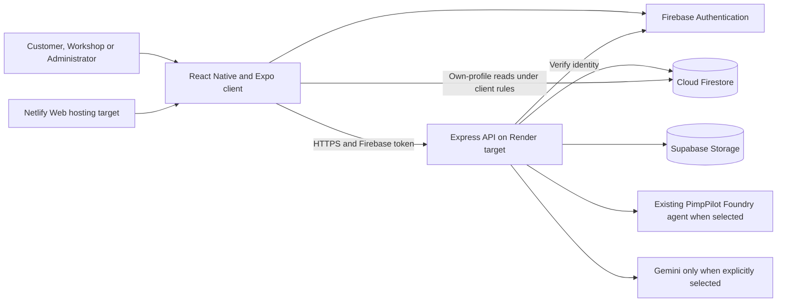
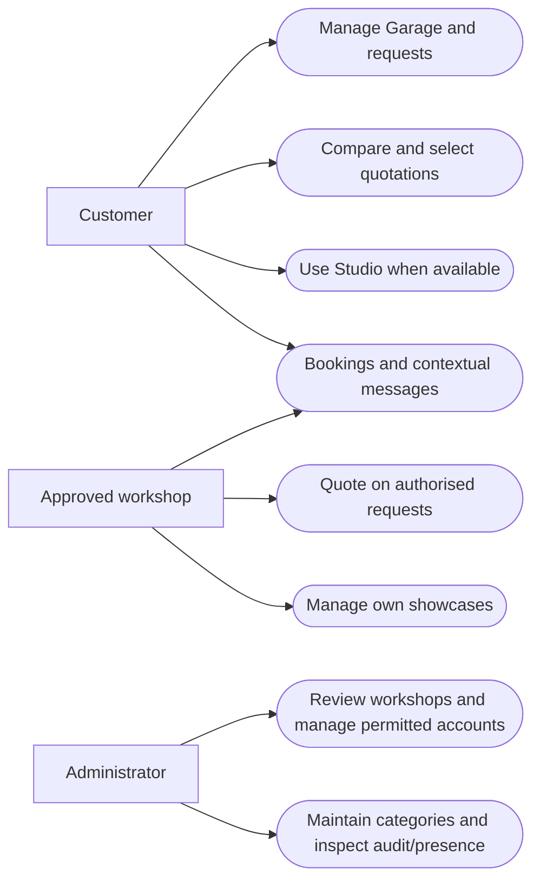
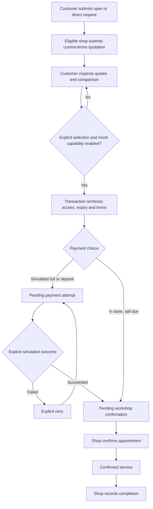
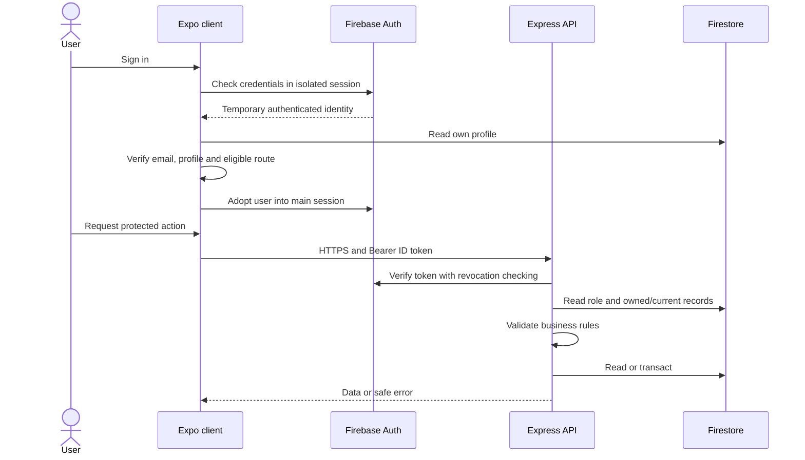
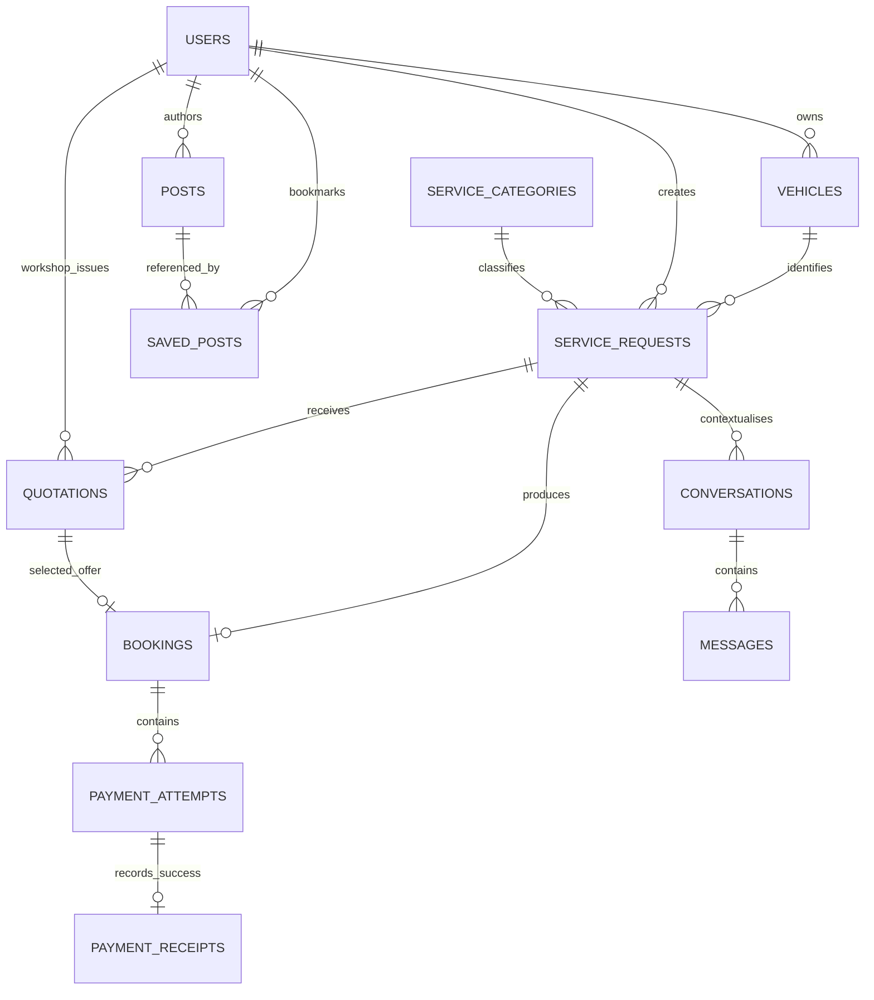
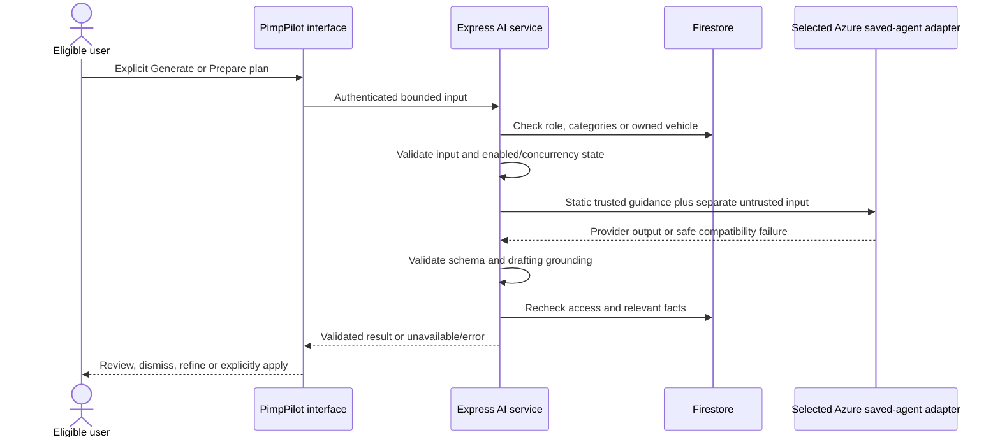

# PimpMyRide
## Automotive Customisation Marketplace
### Final academic project report

**University of Johannesburg**  
**Diploma in Business Information Technology**  
**Development Software 2B — DSW02B1**  
**Project type:** Group software development project  
**Group name:** [Complete group name]  
**Group members and student numbers:** [Complete names and student numbers]  
**Lecturer:** [Complete lecturer name]  
**Submission date:** 29 October 2026  
**Presentation date:** 2 November 2026  
**Documentation evidence cut-off:** 27 October 2026  
**Inspected baseline:** original `PimpMyRide` repository, branch `lesley`, commit `0d7b95f`

**Academic review copy.** Implementation claims are based on inspected source/configuration and identified saved evidence. Screenshots, signatures and student metadata require completion. Current cloud deployment and successful live Azure generation are not certified by this report. Repository paths are relative to the inner application root. Evidence IDs refer to the companion [Documentation Evidence Index](PimpMyRide_Documentation_Evidence_Index.md).

## Declaration of originality — draft for student review and signature

We, the undersigned students, will review this report and the accompanying application before submission. Subject to that review, we declare that the submitted work represents our group's work except where sources, reused resources, external assistance and permitted tools are acknowledged. We understand that we remain responsible for technical accuracy, appropriate attribution and compliance with University of Johannesburg assessment requirements. This draft does not establish verified originality or imply that it has already been signed.

| Student name | Student number | Signature | Date |
| --- | --- | --- | --- |
| [Complete] | [Complete] | [Sign after review] | [Complete] |
| [Complete] | [Complete] | [Sign after review] | [Complete] |
| [Add rows as required] | | | |

## Acknowledgements

[Students should add acknowledgements that accurately reflect assistance received, including lecturer guidance, external resources, permitted AI/documentation assistance and any approved testing support. No individual contribution is inferred from repository history.]

## Abstract / executive summary

PimpMyRide addresses the need to organise communication and decisions between vehicle owners and automotive customisation workshops. The application brings workshop discovery, vehicle records, service requests, itemised quotations and booking records into a role-based marketplace. Customers manage their Garage and requirements; approved workshops respond with quotations and publish showcases; administrators oversee accounts, workshop verification, categories and audit activity.

The inspected implementation uses React Native with Expo for the client and a Node.js/Express API for privileged operations. Firebase Authentication identifies users, Cloud Firestore stores application records, and Supabase Storage holds media. Existing Render and Netlify configurations identify backend and Web hosting targets. Transactional checks, request revisions, operation receipts and private-media access controls address consistency and access concerns across these services.

PimpPilot provides implemented drafting assistance and a Studio concept-planning interface. Its Azure adapter targets the existing Microsoft Foundry agent. Source and automated evidence establish request construction, access checks, structured-output handling and user-review boundaries. They do not establish successful live Azure operation: recorded HTTP 400 incompatibilities led to local request corrections, while successful live generation remains unverified. Studio image editing is unavailable. Payments and payment-related receipts are explicitly simulations, not real financial settlement.

Saved evidence inspected for this report includes 618 passing frontend tests, 341 passing backend tests, a later 14-test focused Studio run, 85 passing emulator checks, a guarded Web export and earlier native bundle exports. These runs have different scopes and must not be added together as a unique-test total. The report distinguishes implemented features, historical verification and outstanding manual/live checks. It documents the application as a substantial academic implementation with specific release and evidence limitations, rather than presenting it as unconditionally production-ready.

## Table of contents

Page numbers must be generated in the final Word/PDF layout.

1. [Introduction](#chapter-1-introduction)
2. [Requirements analysis](#chapter-2-requirements-analysis)
3. [System analysis and design](#chapter-3-system-analysis-and-design)
4. [Technology stack](#chapter-4-technology-stack)
5. [Database and data management](#chapter-5-database-and-data-management)
6. [System implementation](#chapter-6-system-implementation)
7. [PimpPilot AI agent](#chapter-7-pimppilot-ai-agent)
8. [System security](#chapter-8-system-security)
9. [Testing and quality assurance](#chapter-9-testing-and-quality-assurance)
10. [Deployment and maintenance](#chapter-10-deployment-and-maintenance)
11. [Challenges, limitations and future work](#chapter-11-challenges-limitations-and-future-work)
12. [Conclusion](#chapter-12-conclusion)
13. [References](#references)
14. [Appendices](#appendices)

### List of figures

- Figure 3.1: System architecture and service boundaries.
- Figure 3.2: Actor/use-case model.
- Figure 3.3: Service Request → Quotation → Booking activity.
- Figure 3.4: Authentication and authorised API sequence.
- Figure 5.1: Conceptual Firestore entity relationships.
- Figure 6.1: Customer sign-in and email-verification journey (capture required).
- Figure 6.2: Customer Discover and Studio launch (capture required).
- Figure 6.3: Approved workshop discovery/profile (capture required).
- Figure 6.4: Garage details and private-photo management (capture required).
- Figure 6.5: Service Request preparation and audience (capture required).
- Figure 6.6: Current quotation comparison and explanation (capture required).
- Figure 6.7: Simulation-labelled payment choice and booking detail (capture required).
- Figure 6.8: Studio landing, original-photo workspace and availability (capture required).
- Figure 6.9: Workshop request detail and quotation preparation (capture required).
- Figure 6.10: Workshop showcase management/review (capture required).
- Figure 6.11: Administrative Overview (capture required).
- Figure 6.12: Workshop application review and redacted audit activity (capture required).
- Figure 7.1: PimpPilot provider request and response flow.

### List of tables

- Table 2.1: Numbered functional requirements and implementation evidence.
- Table 2.2: Non-functional requirements and verification limits.
- Table 2.3: Requirements-to-test traceability.
- Table 4.1: Verified technology stack and architectural roles.
- Table 5.1: Principal application collections.
- Table 7.1: AI implementation and live-verification status.
- Table 8.1: Security controls and residual limits.
- Table 9.1: Recorded verification results.
- Table 10.1: Configuration categories, by variable name only.
- Table 11.1: Limitations and proposed follow-up work.

### Abbreviations and acronyms

| Term | Meaning |
| --- | --- |
| AI / API | Artificial intelligence / Application programming interface |
| Auth / UID | Authentication / User identifier |
| CORS | Cross-Origin Resource Sharing |
| CRUD | Create, read, update and delete |
| DFD / ER | Data-flow diagram / Entity relationship |
| EFT | Electronic funds transfer; simulated in this application |
| HTTP / HTTPS | Hypertext Transfer Protocol / HTTP protected by TLS |
| JSON / JWT | JavaScript Object Notation / JSON Web Token |
| RBAC / RLS | Role-based access control / Row-level security |
| SDK / UI / UX | Software development kit / User interface / User experience |
| UML / ZAR | Unified Modeling Language / South African rand |

## Chapter 1: Introduction

### 1.1 Background of the project

Vehicle customisation involves matching an owner's goals with work a workshop can assess, price and perform. A request may combine cosmetic preferences with practical constraints such as budget, vehicle details and service timing. PimpMyRide was implemented as an academic marketplace in which those requirements can be recorded, compared and followed through a booking workflow. The name is branding; the implemented system is a service coordination application, not a vehicle engineering or diagnostic authority.

### 1.2 Automotive customisation and digital marketplace context

This project treats discovery, request specification and quotation selection as related information-management problems. Workshop examples help an owner describe a preferred direction, but a showcase does not itself establish price or vehicle compatibility. A structured marketplace can link inspiration to an explicit service request and then to workshop-supplied terms. This is the project's design rationale; no industry market-size statistics, customer survey results or independently measured demand are claimed.

### 1.3 Problem statement

When vehicle details, desired work, quoted inclusions and booking decisions are kept separately, customers can struggle to compare offers consistently. Workshops also need sufficiently precise requests and clear authority to communicate with potential customers. Administrators require a controlled way to assess workshop applications without exposing verification documents publicly. The project therefore addresses fragmented requirement capture, offer comparison and access-controlled coordination. These problems are inferred from the implemented workflow and assignment context, not from an undocumented field study.

### 1.4 Proposed solution

PimpMyRide combines a Customer Discover experience, a private Garage, open or directly invited service requests, workshop quotations, explicit offer acceptance and booking management. Administrative approval controls workshop marketplace access. Contextual messaging and in-app notifications connect the workflow. PimpPilot supports wording assistance and an implemented Studio interface, subject to provider availability and user review. Sources: the role navigators, `backend/marketplace.cjs`, `backend/messaging.cjs` and `backend/services.cjs` (E01–E12).

### 1.5 Project aim

The aim is to provide a coherent, role-based automotive service marketplace that helps owners specify work, inspect workshop proposals and coordinate an authorised booking while keeping sensitive account and media operations behind enforceable controls.

### 1.6 Specific objectives

The implemented objectives were to establish verified account access, manage owned vehicle records, support workshop discovery, capture valid service requirements, receive and compare itemised quotations, create one authoritative booking from accepted terms, maintain controlled communication and provide administrator oversight. An additional objective was AI-assisted drafting and concept planning with explicit human review. Real payment settlement and generated edited vehicle imagery were not delivered and are excluded from completed objectives.

### 1.7 Target users and stakeholders

Customers are represented internally by `owner`; workshops by `shop`; administrators by `admin`. Pending workshops are stakeholders in onboarding but do not receive an approved-shop marketplace session. Lecturers and assessors evaluate implementation quality and evidence; maintainers operate the existing infrastructure. No names, contribution allocations or external workshop partnerships are assumed.

### 1.8 Scope and boundaries

The scope includes implemented customer/workshop/admin interfaces, Firebase-backed domain records, private media storage, simulated payment accounting, notices and contextual messaging, deterministic quotation comparison, and AI integration source. Live Azure success, automated image editing, real payment processing, outbound transactional email, app-store distribution and guaranteed hosted revision parity are outside verified completion. Historical compatibility code is distinguished from currently exposed navigation.

### 1.9 Significance and expected benefits

The system can reduce repeated entry by linking vehicles to requests, improve offer inspection through structured line items and preserve accepted terms through booking snapshots. Approval and ownership checks make information access deliberate. These are expected benefits of the design; no measured improvement in user satisfaction, conversion, cost or time is asserted.

### 1.10 Organisation of the report

The report proceeds from requirements and design to technologies, data structures and role-based implementation. A dedicated AI chapter records the current integration state. Security, verification and deployment chapters then explain how claims were checked and where evidence ends. The final chapters identify limitations and justified future work.

## Chapter 2: Requirements analysis

### 2.1 Functional requirements

Requirements below were reconstructed from implementation and the supplied project brief. They are not represented as a recovered original signed specification. **Implemented** means supported by inspected code; it does not automatically mean demonstrated on the deployed application. Priority expresses dependency on the marketplace objective, not an undocumented team prioritisation exercise.

**Table 2.1. Numbered functional requirements and implementation evidence**

| Requirement ID | Description | Priority | Implementation status | Source evidence |
| --- | --- | --- | --- | --- |
| FR01 | Register owner/shop; verify email before persisted marketplace access | Must | Implemented | `src/features/auth/services/accounts.js`; `backend/services.cjs` |
| FR02 | Route eligible users by role and restrict pending/rejected shops | Must | Implemented | `src/navigation/AppNavigator.js`; `src/features/auth/utils/registration.js` |
| FR03 | Create/edit/archive/restore own vehicles | Must | Implemented | `OwnerMarketplaceScreens.js`; `backend/marketplace.cjs` |
| FR04 | Discover authorised showcases and approved workshops | Must | Implemented | `CustomerDiscoverScreen.js`; `backend/posts.cjs`; `marketplace.cjs` |
| FR05 | Submit/edit/close open or direct service requests | Must | Implemented | `OwnerMarketplaceScreens.js`; `marketplace.cjs` |
| FR06 | Permit approved shops to quote authorised current requests | Must | Implemented | `ShopMarketplaceScreens.js`; `marketplace.cjs` |
| FR07 | Compare valid offers and explicitly select one | Must | Implemented; advisory ranking is deterministic | `QuoteComparisonScreen.js`; `backend/quote-recommendations.cjs` |
| FR08 | Create one booking using authoritative accepted terms | Must | Implemented; acceptance gated by mock capability | `backend/marketplace.cjs`; `mock-payment-gate.cjs` |
| FR09 | Simulate full/deposit/in-store payment lifecycle | Should | Implemented simulation only | `PaymentChoiceScreen.js`; `backend/payment-provider.cjs` |
| FR10 | Confirm/cancel booking and record service completion | Must | Implemented state checks | `BookingScreens.js`; `backend/booking-domain.cjs` |
| FR11 | Publish/edit/remove own workshop showcases | Should | Implemented approved-shop UI/API | `PostScreens.js`; `backend/posts.cjs` |
| FR12 | Bookmark published posts | Should | Implemented | `PostCard.js`; `backend/posts.cjs`; `firestore.rules` |
| FR13 | Authorise private conversations by request/quote/consent/booking | Should | Implemented; not unrestricted chat | `backend/messaging.cjs`; `MessagingScreens.js` |
| FR14 | Record in-app notifications and simulated receipts | Should | Implemented; email is test sink | `marketplace-communications.cjs`; `CommunicationScreens.js` |
| FR15 | Review workshop documents, accounts and service categories | Must | Implemented admin checks and recovery | `AdminScreens.js`; `backend/services.cjs`; `reviews.cjs` |
| FR16 | Inspect audit history and bounded presence information | Should | Implemented | `AdminHomeScreen.js`; `backend/presence.cjs` |
| FR17 | Review/apply PimpPilot text suggestions explicitly | Should | Frontend/backend implemented; Azure live success unverified | `AIAssistButton.js`; `backend/ai-assist.cjs` |
| FR18 | Plan/refine a Studio concept for own active vehicle | Should | Interface/backend implemented; availability conditional | `PimpPilotStudioScreen.js`; `backend/ai-studio.cjs` |
| FR19 | Transfer selected Studio scopes to unsaved request form | Should | Implemented; separate submission required | `pimpPilotStudio.js`; `OwnerMarketplaceScreens.js` |
| FR20 | Generate an edited vehicle image | Could | Unavailable, not implemented | `StudioUI.js`; `backend/ai-studio-contract.cjs` |

Frontend basenames in this table are under `src/features/marketplace` except Customer and Admin screens, which are under their corresponding feature folders. Full repository-relative mappings appear in E01–E35 of the evidence index.

### 2.2 Non-functional requirements

**Table 2.2. Non-functional requirements and verification limits**

| ID | Requirement | Implementation evidence | Qualification |
| --- | --- | --- | --- |
| NFR01 | Enforce authenticated, least-necessary role/ownership access | `backend/app.cjs`, `services.cjs`, domain services | No independent penetration-test certification |
| NFR02 | Prevent duplicate or stale marketplace mutations | `backend/mutations.cjs`, version/terms checks | Cross-service Auth/Storage changes need recovery patterns |
| NFR03 | Keep new media private and credentials server-side | `backend/storage.cjs`, `config.cjs` | Remote policy and bearer-URL lifetime still matter |
| NFR04 | Support readable mobile/Web layouts and keyboard use | Customer/shared UI, safe areas, theme tokens | Device and visual acceptance remain manual |
| NFR05 | Bound requests, uploads and provider execution | Parser limits, rate limiters, deadlines | No load-test throughput/SLA claim |
| NFR06 | Present truthful loading/error/unavailable states | Hooks, API clients and Studio UI | Automated state tests do not replace hosted UX review |
| NFR07 | Make behavior testable and maintainable | Feature modules, pure validators, mock/emulator suites | No configured lint/typecheck or coverage percentage |

### 2.3 Customer requirements

A customer needs to identify an owned vehicle, describe required work, decide whether to invite one shop or expose an open request, and inspect the terms actually supplied by workshops. The Garage keeps registration private; shared request/booking snapshots use make/model/year/colour. A recommendation cannot substitute for inspecting scope or explicitly accepting an offer. Source: `backend/marketplace-domain.cjs` and `backend/marketplace.cjs`.

### 2.4 Workshop requirements

A workshop must provide business information and verification documents, wait for approval, view eligible requests, quote against their current material revision and manage its own subsequent bookings. Its showcase publishing rights are separate from merely possessing a login. The backend rechecks approved/active status rather than trusting a visible navigation tab. Source: `backend/documents.cjs`, `reviews.cjs`, `marketplace.cjs`, `posts.cjs`.

### 2.5 Administrator requirements

An administrator needs account/application lists, reviewable private documents, reasons for decisions, category maintenance and an audit trail. Administrative identity requires both a privileged claim and current profile/Auth checks. Sensitive actions require recent authentication; self-administration and administration of other admin accounts are restricted by the trusted provisioning boundary. Sources: `backend/services.cjs`, `backend/domain.cjs`, `src/features/admin`.

### 2.6 Business rules

Only active, owned, non-archived vehicles can support new requests and Studio generation. Requests refer to active categories; direct invitations identify an eligible shop. Quotations use integer ZAR cents, valid line items, expiry dates and current material request revisions. Replaced offers become superseded; withdrawn offers cannot simply be resubmitted. Acceptance creates one request-scoped booking, with payment, appointment and service-completion states kept separate. Explicit simulation capability is required even for acceptance into the demonstrated booking workflow. Sources: `backend/marketplace.cjs`, `marketplace-domain.cjs`, `booking-domain.cjs`, `mock-payment-gate.cjs`.

### 2.7 Authentication and authorisation requirements

Email verification, role selection and account status are different checks. Registration permits owner/shop only; an administrator cannot acquire privilege by choosing an admin role on signup. Express verifies revoked tokens and services consult current Auth/profile state. Ownership and lifecycle rules are checked for individual records. Frontend role routing improves usability but is not the security boundary. Sources: E01–E05, E24.

### 2.8 Data and media-management requirements

Metadata belongs in Firestore and binary content in scoped Supabase buckets. New stored references include stable bucket/path identity rather than expiring access URLs. Image/document content is validated beyond filename extensions. Upload intents and cleanup state preserve evidence when an acknowledgement or cross-service update fails. A private image may become viewable only through a permitted request/booking relationship; it does not become a generally public Garage photo. Sources: `backend/photos.cjs`, `documents.cjs`, `photo-domain.cjs`, `storage.cjs`.

### 2.9 AI agent requirements

AI must help the user without silently changing marketplace records. Drafting is bounded rewriting and clarification, with source-fact preservation, category restrictions and explicit Apply. Studio is a different mode: preliminary automotive proposals grounded in server-supplied vehicle facts, with assumptions and workshop checks. Neither path may submit a service request, book a job or imply that image editing was completed. Availability failures must preserve user work and must not trigger an automatic alternative-provider generation. Sources: E17–E23.

### 2.10 Requirements traceability matrix

**Table 2.3. Requirements-to-test traceability**

| Requirements | Principal test files | What the evidence can establish |
| --- | --- | --- |
| FR01–02, NFR01 | `tests/auth.test.cjs`, `accounts.test.cjs`, `firebase-isolation.test.cjs`; `backend/test/security.test.cjs` | Authentication/profile/session logic under test doubles and emulator evidence |
| FR03–06, NFR02 | `tests/marketplace-owner.test.cjs`, `garage-ui.test.cjs`, `marketplace-shop.test.cjs`; `backend/test/marketplace.test.cjs` | Ownership, validation, revision and role workflows |
| FR07–10 | `tests/quote-comparison.test.cjs`, `quote-recommendations.test.cjs`, `bookings-ui.test.cjs`; backend marketplace/mock configuration tests | Comparison decisions and simulated lifecycle, not real settlement |
| FR11–14 | `tests/shop-showcase-ui.test.cjs`, `messaging.test.cjs`, `notifications-ui.test.cjs`; backend posts/photos tests | Rendered behavior and controlled domain access |
| FR15–16 | `tests/admin-dashboard.test.cjs`, `admin-api.test.cjs`; `backend/test/reviews.test.cjs`, `trusted-admin-operations.test.cjs` | Administrative boundaries and failure handling |
| FR17–19 | `tests/ai-assist.test.cjs`, `pimppilot-studio.test.cjs`; `backend/test/ai-azure.test.cjs`, `ai-grounding.test.cjs`, `ai-studio.test.cjs` | Mock/intercepted SDK behavior, not live Azure success |
| FR20 | Studio contract/UI tests | Honest unavailability, not edited-image generation |
| NFR03–07 | Storage, upload, UI, production-export and rule suites | Scoped checks; no general compliance, SLA or device-certification claim |

The companion testing document maps these files to actual saved runs and remaining checks. Listing a test file alone is not a pass result.

## Chapter 3: System analysis and design

### 3.1 Overall system architecture

The application separates client presentation from privileged business operations. Firebase Authentication issues identity tokens; Express validates them and coordinates Firestore and Storage access. This permits the same server-side rules to govern Customer, Workshop and Admin clients. The design also permits limited direct Firestore operations explicitly allowed by rules, so it is inaccurate to describe all database traffic as exclusively API-mediated.

**Figure 3.1. System architecture and service boundaries**

Source: `backend/server.cjs`, `services.cjs`, provider selectors and `src/shared/services/firebase.js`. The hosting nodes identify inspected targets, not a newly verified deployment.

### 3.2 Client-server architecture

The client supplies user intent and current revision identifiers, not authoritative role, ownership or financial totals. The backend derives actor identity from the token, validates permitted keys and reads authoritative records before writing. Error envelopes preserve predictable client handling. Cursors bound list reads; server timestamps and transaction receipts support ordering and replay. This reduces trust in client-supplied state, although the server and its privileged credentials remain a significant trust boundary.

### 3.3 Frontend architecture

`src/features` groups authentication, Customer presentation, administrative screens and marketplace capabilities. `src/shared` provides Firebase/API transport, theme, controls, offline-profile caching and location utilities. Role-specific native-stack navigators select screens; reusable Customer/Marketplace/Booking/Quotation components supply consistent layouts. Hooks such as `useMarketData` and `usePostsFeed` coordinate focus, pagination, errors and refresh. No Redux, Expo Router or TypeScript architecture is asserted because the inspected application uses JavaScript modules and React state/context.

### 3.4 Backend architecture

`backend/app.cjs` constructs HTTP middleware and routes. `services.cjs` composes shared actor checks, administrative/profile operations and feature services. Marketplace, posts, photos, messaging, documents and AI modules encapsulate business rules. Pure domain helpers validate values, while storage/provider adapters isolate external I/O. This is a modular Express service, not a microservice system; the repository does not justify distributed-service claims.

### 3.5 External services and integrations

Firebase performs authentication and application persistence; Supabase handles scoped object storage; Azure/Gemini adapters provide explicitly selected AI execution. Render and Netlify configuration support API/static-Web hosting. Email verification/password recovery use Firebase mechanisms. The marketplace's payment-related email events go to a test outbox, not a verified mail provider. No payment gateway, independent automotive database or vehicle-specification lookup is evidenced.

### 3.6 Role-based application navigation

The root navigator exposes only the current eligible role's authenticated stack. Customers have five main destinations: Discover, Garage, Requests, Bookings and Profile. Studio is a stack route launched from Discover or Garage, avoiding a sixth tab. Workshops use Find Jobs, Requests, Quotes, Bookings and My Shop, with account, messaging, showcase and detail routes. Admin screens include Overview, Accounts/Applications, Categories, Activity Log, Online Status and identity confirmation. Source: `OwnerNavigator.js`, `ShopNavigator.js`, `AdminNavigator.js`, CustomerUI and ShopBottomNavigation.

### 3.7 Main business processes

Request creation fixes the owner, vehicle and category relationship. Quotation submission records terms and the request revision; a material edit prevents acceptance of a stale offer. Comparison is advisory and acceptance is explicit. The chosen offer is copied into a booking transaction so later browsing does not overwrite accepted terms. Upload and review processes additionally track intent and recovery because their external calls cannot be committed atomically with Firestore.

### 3.8 Use-case model and descriptions

**Figure 3.2. Actor/use-case model**

This is a Mermaid representation of a use-case model, not strict UML ellipse semantics. In **Create Request**, the precondition is an eligible customer with an active owned vehicle; success stores an open/direct request, and failure retains the form for correction. In **Submit Quotation**, the precondition is an approved shop with access to the current request; success records its current-terms offer, and stale terms require refresh. In **Approve Workshop**, the admin must have recent identity confirmation and valid private documents; success grants approved status, while partial failure remains restricted or recoverable. Sources: corresponding domain modules.

### 3.9 Activity diagrams

**Figure 3.3. Service Request → Quotation → Booking activity**

The simplified diagram does not collapse service completion into payment success. Cancellation and later balance payments are additional checked actions. Source: `backend/marketplace.cjs`.

### 3.10 Sequence diagrams

**Figure 3.4. Authentication and authorised API sequence**

The full sequence with onboarding qualification is reproduced in the diagram companion. Source: `accounts.js`, `api.js`, `backend/app.cjs`, `backend/services.cjs`.

### 3.11 Data-flow diagrams

Figure D7 in [System Diagrams](PimpMyRide_System_Diagrams.md) supplies a private-media flow: chosen file → client preparation → authenticated upload → validation/intent ledger → Supabase binary plus Firestore reference → relationship-authorised signed access. It separates the stored object from the transient URL presented to a viewer. The API/database appendix records each endpoint and collection used by that flow.

### 3.12 User-interface design principles

The UI uses role-appropriate terminology, shared typography and themes, visible loading/error states, safe-area layouts and keyboard-aware scrolling. Customer controls include accessible labels, focus states and sufficiently sized actions; Studio uses wrapping interest chips and a numbered workflow. Theme preference is persisted locally. `app.json` fixes portrait orientation and does not claim iPad support; responsive Web components do not establish native tablet certification. Accessibility implementation is evidenced, but a formal conformance audit was not supplied.

### 3.13 Key technical design decisions

Server-mediated mutations centralise business rules that cannot safely depend on screen state. Integer cents avoid floating-point currency calculations. Denormalised vehicle/offer snapshots preserve accepted context, while version/terms checks prevent stale selection. Stable storage identities prevent signed-URL expiry from corrupting record identity. An explicit user-review boundary limits AI side effects. These are architectural explanations of the implemented design, not invented accounts of why the team historically chose each technology.

## Chapter 4: Technology stack

**Table 4.1. Verified technology stack and architectural roles**

| Technology | Version verified in repository | Purpose | Architectural reason for use |
| --- | --- | --- | --- |
| JavaScript / CommonJS | No language-version claim | ES-module client; `.cjs` backend/scripts | One application language with distinct runtime boundaries |
| React | 19.2.3 | Component/state/context model | Composable presentation and lifecycle management |
| React Native | 0.86.3 | Mobile UI primitives | Shared application presentation across native targets |
| Expo | Manifest `~57.0.0`; lock 57.0.20 | Metro, permissions, image/media/location modules, export | Integrated development and platform tooling |
| React Native Web | Manifest `^0.21.2` | Browser rendering | Reuses compatible native components for Web |
| React Navigation | Manifest `^7.0.0`; lock native 7.3.18 | Native-stack navigation | Role/detail/modal routing without replacing app architecture |
| Node.js | Backend engine `22.x`; historical verification reports 22.23.3 | Backend and test runtime | Matches backend SDK/runtime requirement |
| Express | Backend manifest `^5.1.0`; lock 5.2.1 | HTTP service | Middleware and route composition; do not confuse root transitive Express 4.22.3 with backend runtime dependency |
| Firebase client SDK | 12.19.0 | Authentication and permitted direct reads | Identity/session integration with Firestore |
| Firebase Admin SDK | 14.4.0 | Server Auth and Firestore | Authoritative token/account/domain access |
| Cloud Firestore | Managed service; no server version verified | Document database | Referenced documents, queries, transactions and snapshots |
| Supabase JavaScript | Backend manifest `^2.0.0`; lock 2.116.0 | Storage API client | Scoped binary media storage separate from application metadata |
| Microsoft Foundry SDK | `@azure/ai-projects` 2.9.0 | Existing saved-agent client | Agent-bound provider adapter; live compatibility still limited |
| Azure Identity | 4.14.0 | Server Entra application credentials | Deterministic service credential, not end-user Firebase replacement |
| Helmet / express-rate-limit / Multer | Backend lock 8.3.0 / 8.7.0 / 2.4.0 | Headers, request limits, multipart parsing | Layered HTTP/input controls |
| Node test runner / strict assert | Runtime built-ins | Unit/integration harness | Repeatable executable assertions without a separate runner dependency |
| React test renderer | 19.2.3 | Component behavior tests | Synthetic UI interaction and state coverage; not real device rendering |
| Supertest | Backend lock 7.2.2 | Express HTTP tests | Middleware/route checks without a public deployment |
| Firebase rules testing | Manifest `^5.0.2` | Emulator security rules tests | Local enforcement checks without production writes |
| Render / Netlify | Managed service versions not verified | API / static-Web hosting targets | Separates server runtime from exported client hosting |
| Git / GitHub | Git executable version not recorded | Source history and configured remote | Traceable revisions; no contributor-role inference |

Evidence: root/backend manifests and lockfiles, `render.yaml`, `.netlify/netlify.toml`, Git read-only inspection (E29–E33). Manifest ranges express allowed resolution; lockfile versions identify the inspected resolution. They are not guarantees about the package versions on a hosted runtime.

React Native, Expo, navigation, Express, Firebase, Supabase and Foundry official documentation provide the technical context for these roles (React Native, n.d.; Expo, n.d.; React Navigation, n.d.; Express, n.d.; Google, n.d.-a, n.d.-b; Supabase, n.d.; Microsoft, n.d.-a). These references explain platform concepts; application implementation claims come from the repository.

## Chapter 5: Database and data management

### 5.1 Database overview

Cloud Firestore stores identity-linked profiles and marketplace metadata. It is not a relational SQL database, and the application does not use Supabase Postgres as its business-record store. Supabase's role here is binary object storage. Firebase Authentication user identities are separate from Firestore profile documents even when both share the same UID.

### 5.2 Cloud Firestore architecture

Firestore organises documents within collections and allows nested subcollections (Google, n.d.-b). PimpMyRide uses top-level domain collections plus nested messages, bookmarks, documents and payment attempts. Server timestamps and query indexes support predictable ordering; API serialisation turns Firestore timestamps into client-friendly millisecond values. The database itself is schemaless, so application validators and transactions are central to integrity.

### 5.3 Collections and document structures

**Table 5.1. Principal application collections**

| Collection | Responsibility | Principal references |
| --- | --- | --- |
| `users` | Role, account/business/verification profile | Firebase Auth UID |
| `vehicles` | Private Garage record and photo slots | ownerId |
| `serviceCategories` | Administrative service catalogue | categoryId in requests |
| `serviceRequests` | Requested work, budget, visibility and revisions | ownerId, vehicleId, categoryId, optional shopId |
| `quotations`, `quotationHeads` | Offer history and current offer pointer | serviceRequestId, shopId, quoteId |
| `bookings` | Accepted terms, appointment and simulated accounting | Request-scoped ID, quoteId, ownerId, shopId |
| `paymentReceipts` | Explicit simulated payment snapshots | bookingId, attemptId |
| `posts` | Workshop showcase content and media references | authorId/shopId |
| `marketplacePhotos` | Vehicle/request image metadata | ownerId, vehicleId, upload attempt |
| `conversations` | Contextual consent and message counters | request/customer/shop relationship |
| `notifications`, `emailOutbox` | In-app notices and test email events | recipient/booking/typed target |
| `auditLogs`, `presence` | Administrative trace and expiring session activity | Actor/UID |
| Operational ledgers | Replay/review/upload/recovery records | Described in API/database appendix |

Nested collections include `users/{uid}/documents`, `users/{uid}/savedPosts`, `bookings/{id}/paymentAttempts` and `conversations/{id}/messages`. Exact representative fields and operational collection names appear in [API and Database Reference](PimpMyRide_API_and_Database_Reference.md), Tables A5–A6.

### 5.4 Entity relationships

**Figure 5.1. Conceptual Firestore entity relationships**

These are logical references enforced in code, not Firestore foreign-key constraints. A shop is a specialised `users` document. Snapshots intentionally duplicate display/accepted terms; they are not independently authoritative copies of every related record. Source: domain service document paths and transaction writes.

### 5.5 User profiles and roles

Profiles contain name, email, phone, role and terms acceptance; shops add business data and verification status. Account restrictions and pending administrative operations limit access. Native persisted authentication uses SecureStore-backed chunked persistence; Web uses Firebase's Web Auth path. The offline profile cache expires after 24 hours and does not grant fresh privileged API access; Admin access requires connectivity. Sources: `firebase.js`, `securePersistence.js`, `profileCache.js`, `AuthContext.js`.

### 5.6 Vehicle data

Owned vehicles include make, model, year, colour and registration, with versions, archive state and photo references. Archiving retains historical relationships rather than deleting booking evidence. Shared snapshots include make/model/year/colour and exclude registration. Version checks reject editing a stale record; ownership is derived from stored ownerId, not from a route parameter alone.

### 5.7 Workshop profiles and verification

The shop map holds business name, registration number, address, city, province, services and optional selected coordinates. Verification documents have fixed supported kinds and private storage paths. Approval checks Auth eligibility and the referenced documents; a review operation marks work in progress and preserves recovery information. Verification states and account states are distinct: an approved but suspended account is still ineligible. Sources: `domain.cjs`, `documents.cjs`, `reviews.cjs`, `shop-location.cjs`.

### 5.8 Service requests

Requests capture work details, vehicle/category snapshots, ZAR budget bounds, preferred date, city, optional service coordinates and selected images. Visibility is open or direct. A direct request identifies its workshop; an open request must not secretly retain a target shop. Material edits advance terms revision so prior quotations cannot be accepted without matching the changed requirement. Preferred dates use the South African date boundary when newly validated.

### 5.9 Quotations

Quotations store an itemised scope and server-calculated integer-cent total, optional deposit terms, completion estimate, warranty and expiry. Current quotation heads identify the latest legitimate offer for a request/shop pair while retaining superseded history. Full-scope/all-charge declarations and mandatory-service coverage can support comparison; they remain workshop declarations, not independently inspected quality certifications.

### 5.10 Bookings

Acceptance copies authoritative offer terms into a booking whose ID matches the service request. This transaction links request, accepted quote and booking together. A booking may be pending payment, pending confirmation, confirmed or cancelled; service completion is represented separately. Appointments retain the entered South African date/time and an absolute timestamp. Payment balance is also separate from service status, avoiding the false implication that completed work necessarily means paid work.

### 5.11 Showcases and bookmarks

Current workshop showcases record title, description, service category, vehicle details, image references and supplied shop identity/location. Customers can browse and save posts. Bookmarks are per-user documents keyed by post ID. Legacy customer-build operation support does not prove a customer publishing interface: the current Customer navigator does not register PostForm/MyPosts, and the MyPosts create entry is disabled for non-shops. Sources: `posts.cjs`, `PostScreens.js`, `OwnerNavigator.js`.

### 5.12 Payment-related records

Bookings, attempts and receipts are explicitly marked simulated/test. Pending attempts do not reduce balances; successful confirmed simulation does. Deposit and balance amounts are computed from saved authoritative terms. In-store recording is restricted to the selected workshop and still represents simulation. Receipts use test identifiers; email events are a test sink. There is no evidence of card acquiring, bank settlement, refunds through a real processor or legally certified invoices. Sources: `marketplace.cjs`, `payment-provider.cjs`, `marketplace-communications.cjs`.

### 5.13 Access rules and validation

Client Firestore rules permit own-profile reads and narrow post/bookmark access, while core domain writes go through the API. A restricted direct admin post-removal update is also explicitly present; it is inaccurate to claim that every post write is universally blocked at rules level. Admin SDK access bypasses these rules, making backend validation essential. Query indexes in the repository support known access patterns but are not evidence of current deployed index completion.

### 5.14 Supabase media storage

The server creates scoped storage adapters with a server-only privileged key. Verification, new vehicle/profile, request and showcase media are private. Distinct legacy bucket references are preserved instead of silently reinterpreted as new objects. New objects use generated identifiers; uploads are not persisted to Render's filesystem. SQL setup/proposal documents describe intended bucket state but were not executed during this task.

### 5.15 Private and public media handling

Authorised private viewers receive short-lived signed URLs, normally 60 seconds. UI components renew or discard access while focused and remove stale private context after relevant identity changes. Those URLs are bearer capabilities until expiry; signing does not enable instantaneous revocation of an already issued link. Legacy public-post URLs cannot be treated as private merely by changing metadata. Supabase documents storage-policy controls, but this application delegates user authorisation to its Firebase-authenticated server rather than Supabase user sessions (Supabase, n.d.).

## Chapter 6: System implementation

Screenshots below are explicit placeholders, not evidence of a captured screen. Their capture roles, captions and redaction requirements are specified in [Screenshot Checklist](PimpMyRide_Screenshot_Checklist.md). No live customer record is needed in a submitted figure.

### 6.1 Customer interface

#### 6.1.1 Registration and authentication

Customers provide personal/contact details, a password and terms agreement. The isolated registration flow creates Auth/profile information and requests email verification; only a verified, valid and unrestricted profile is adopted into the main app session. Incomplete signup has a recovery path rather than blindly creating a second profile. Password recovery/resend screens present supported Firebase flows. Sources: `accounts.js`, `SignUpScreen.js`, `ForgotPasswordScreen.js`, `VerifyEmailScreen.js`.

**Figure 6.1 — screenshot required:** Customer sign-in and email-verification journey. Capture S01/S02; redact personal email and never show a password.

#### 6.1.2 Discover and workshop discovery

Discover provides showcase/workshop views, service categories, search, saved posts and loaded-location filtering. Approved workshop data comes from the existing API, not fabricated cards. Showcase media uses authorised image presentation. Search/filter results are bounded by actual loaded/server-returned data; the interface must not imply exhaustive geographic coverage when only a page is loaded. Sources: `CustomerDiscoverScreen.js`, `usePostsFeed.js`, `postsApi.js`.

**Figure 6.2 — screenshot required:** Customer Discover with service filters and Studio launch. Capture S03.  
**Figure 6.3 — screenshot required:** Approved workshop profile/directory. Capture S04.

#### 6.1.3 Garage and vehicle management

The Garage lists active or archived owned vehicles, provides grouped details and opens edit/photo/service actions. Photos remain private; missing media is represented honestly. Editing preserves revision checks, while removal archives rather than erases linked history. Camera/Gallery support is mediated by platform-aware selection. Sources: `OwnerMarketplaceScreens.js`, `VehiclePhotosScreen.js`, `GarageUI.js`, `PrivatePhoto.js`.

**Figure 6.4 — screenshot required:** Garage vehicle details and private-photo management. Capture S05/S06 with registration redacted.

#### 6.1.4 Service requests

The customer chooses a vehicle, title/description, category, city, budget, preferred date and open/direct audience. Images and optional service/location requirements enrich the request without replacing validation. Submission is an explicit normal-form action. Open requests may be edited or closed; changed terms affect quotation validity. Sources: `RequestFormScreen`/request screens in `OwnerMarketplaceScreens.js`, `CustomerRequestUI.js`, backend request handlers.

**Figure 6.5 — screenshot required:** Service Request form and audience selection before submission. Capture S07.

#### 6.1.5 Quotation review and comparison

Customers inspect scope, itemised totals, deposit, turnaround and warranty. The comparison service first filters current valid offers, then scores sufficiently confirmed ones using price (40%), distance (25%, only when consistently available) and declared full coverage (35%). Missing distance removes that factor for all scored offers; ties produce no recommended winner. Partial-information offers can remain inspectable without qualifying as winners. This is deterministic advisory analysis, not PimpPilot or an independent quality rating. Sources: `QuoteComparisonScreen.js`, `quote-recommendations.cjs`, `quote-recommendation-read.cjs`.

**Figure 6.6 — screenshot required:** Comparison with real terms and explanation or honest insufficient-information state. Capture S08; do not manufacture a winner.

#### 6.1.6 Bookings and simulated payment choices

Selection opens an explicit payment-choice review. When the backend reports simulation capability, full, deposit or in-store choices lead into the checked booking lifecycle. A full/deposit simulation needs a deliberate success/failure confirmation; in-store begins due. Customer booking detail presents appointment, accepted terms, balance/attempt history and permitted cancellation controls. No bank/card payment should be inferred from these screens. Sources: `PaymentChoiceScreen.js`, `BookingScreens.js`, `useMockPayments.js`.

**Figure 6.7 — screenshot required:** Booking detail with clearly visible simulation label. Capture S09/S10.

#### 6.1.7 Saved posts, profile and communications

Saved posts retain bookmarks rather than copying showcase content. Customer Profile provides account information and existing account/theme/photo controls. Notifications link to supported record types, and private messages are tied to a valid business relationship rather than a global public chat. Sources: `CustomerSavedScreen.js`, `CustomerAccountScreen.js`, `AccountScreen.js`, `MessagingScreens.js`, `CommunicationScreens.js`.

#### 6.1.8 PimpPilot and Studio entry points

The service-request form offers PimpPilot drafting assistance. Studio is launched from Discover or a Garage vehicle, using the existing route. It provides a landing explanation, vehicle selection, original-photo preview, interests/instructions, actual-response cards, refinement history and selected-scope draft transfer. An unavailable provider leaves local work intact; edited images are explicitly unavailable. Sources: `AIAssistButton.js`, `PimpPilotStudioScreen.js`, `StudioUI.js`.

**Figure 6.8 — screenshot required:** Studio workspace and original-photo/unavailable state. Capture S20/S21; a recommendation screenshot is conditional on genuine verified availability.

### 6.2 Workshop interface

#### 6.2.1 Registration, verification and profile

Workshop registration includes business details and later supported document uploads after verified sign-in. The pending/rejected Account experience explains access state. An approved workshop can use marketplace and showcase screens. Workshop/service location controls support chosen coordinates and optional device location; they are not background vehicle tracking. Sources: auth/account screens, `VerificationDocuments.js`, `BusinessLocation.js`, `shop-location.cjs`.

#### 6.2.2 Request discovery and quotation management

Find Jobs exposes authorised open/direct requests. The quote form records detailed scope, positive line items, completion, warranty, validity and optional deposit/coverage declarations. The server calculates totals and records the terms version. Quote management distinguishes submitted, expired, replaced, accepted or withdrawn states. A shop cannot quote on behalf of another shop or change an accepted offer's terms. Sources: `ShopMarketplaceScreens.js`, `marketplace.cjs`.

**Figure 6.9 — screenshot required:** Workshop request detail and itemised quotation form. Capture S12/S13.

#### 6.2.3 Booking management

Only the selected shop can confirm the future appointment or record service completion, subject to lifecycle validation. Simulated in-store accounting is distinct from confirming the appointment. The shared booking screens present role-specific actions without granting a customer shop controls. Sources: `BookingScreens.js`, `backend/marketplace.cjs`.

#### 6.2.4 Showcases and workshop PimpPilot assistance

The workshop's My Shop/showcase area supports creation, editing and removal of its own published work with selected media. The current shop branch sends the REST showcase contract, including structured vehicle details and serviceCategory, rather than the legacy customer-build form shape. PimpPilot offers text assistance for the showcase draft, with explicit review/Apply and no automatic publication. Sources: `PostScreens.js`, `postsApi.js`, `AIAssistButton.js`, `backend/posts.cjs`.

**Figure 6.10 — screenshot required:** Workshop showcase editing/review before publication. Capture S14/S15.

### 6.3 Administrator interface

#### 6.3.1 Authentication and dashboard

Administrators use the normal sign-in surface but require current privileged claims and profile status. Dashboard metrics are queried counts, not hardcoded totals. Application/accounts lists expose detail views, while unavailable counts show an honest state. The admin shell supplies navigation, refresh, recent identity confirmation and shared error handling. Sources: `AdminNavigator.js`, `AdminHomeScreen.js`, `AdminShell.js`.

**Figure 6.11 — screenshot required:** Administrative Overview and pending applications. Capture S16.

#### 6.3.2 Approvals and account/category management

An administrator inspects the permitted private workshop documents, records a reason and selects an allowed review outcome. Review markers and recovery prevent partially completed operations from silently granting access. Account suspension/archive/reactivation interacts with Auth revocation/disable handling; category archiving prevents new invalid references. Admin profiles themselves stay within trusted provisioning rather than ordinary in-app editing. Sources: `services.cjs`, `reviews.cjs`, `AdminScreens.js`.

**Figure 6.12 — screenshot required:** Workshop review and redacted audit activity. Capture S17/S18; do not expose identity documents.

#### 6.3.3 Moderation, audit and presence

Post removal is supported through administrative operations with reasons and an audit record, although its available API should not be confused with a separately proven full moderation-console route. Audit/presence screens are registered and implemented. Presence is expiry-based activity, not proof that a person is continuously online. Sources: `services.cjs`, `presence.cjs`, `AdminNavigator.js`.

### 6.4 Shared features

Shared controls provide themes, inputs, confirmation dialogs, media selection and location selection. Hooks handle busy/error/retry and account/focus changes; connection checks prevent ordinary offline mutations. Native secure-session persistence and limited cached profiles provide continuity without granting offline Admin privileges. UI tests exercise state transitions, while safe-area/keyboard/responsive behavior still needs physical and browser review for final presentation. Sources: `src/shared`, CustomerUI, MarketplaceUI, auth context and feature hooks.

## Chapter 7: PimpPilot AI agent

### 7.1 Purpose of PimpPilot

PimpPilot is the application's automotive assistance identity. It supports two distinct tasks: improving supplied request/showcase draft wording, and planning preliminary Studio concepts for an owned vehicle. The distinction is significant: drafting must not introduce new factual work claims, while Studio can propose work with qualifications and assumptions.

### 7.2 Problems addressed by AI assistance

Owners may describe goals without complete service detail, while workshops may benefit from clearer showcase wording. Draft assistance can improve expression and ask neutral clarification questions. Studio can organise an owner's preferences into selectable proposal scopes when generation is available. None of these tasks proves mechanical compatibility or replaces an inspection/quotation by a workshop. Sources: drafting and Studio prompt contracts.

### 7.3 Microsoft Foundry architecture

When `PMR_AI_PROVIDER` selects Azure, server-side adapters use `AIProjectClient` and `ClientSecretCredential`. The agent-bound client targets the existing agent name `PimpPilot`; Firebase continues to authenticate application users. No Azure secret is sent to the client. The repository preserves explicit Gemini adapters, but an Azure failure never invokes Gemini as a hidden fallback. Sources: `ai-provider-selection.cjs`, `ai-studio-provider.cjs`, `ai-azure-provider.cjs`.

### 7.4 GPT-5-mini model deployment

The project context identifies GPT-5-mini and the deployment name `pimppilot-gpt5-mini`. Existing verification notes classify the agent's version/model binding as owner-reported rather than independently inspected. Current code targets the saved agent by name and does not supply a direct model deployment in each response body. This report therefore describes GPT-5-mini as the reported intended agent binding, not a newly verified live deployment. Source: `docs/AZURE_FOUNDRY_VERIFICATION.md` and current provider source.

### 7.5 Foundry agent configuration and role

The existing saved agent supplies model/instruction configuration on the service side. The application adds static mode guidance through a separate developer input message and serialises bounded customer context as user data. It does not create/update an agent, version or persisted provider conversation. Inherited agent tools/shared memory, service retention and preview support constraints need owner-side review. Microsoft's agent/conversation/response model explains these distinct runtime responsibilities (Microsoft, n.d.-b); it does not prove this endpoint accepts every request option.

### 7.6 Backend AI integration

Draft service execution is bounded by account/category checks, a 15-second deadline and concurrency leases. Studio separately validates ownership/history/photo input with a 30-second service deadline. Provider errors become safe application errors with content-free diagnostics where implemented. The Azure request asks for strict JSON output, `store:false`, no streaming and no tools, with zero SDK retries. Current source does not send the two request-level overrides that produced the recorded compatibility failures: top-level `instructions` and `reasoning`.

**Figure 7.1. PimpPilot provider request and response flow**

The return-success branch is implemented and mock-tested, not proof of live generation. Source: `backend/ai-assist.cjs`, `ai-studio.cjs`, `ai-azure-provider.cjs`.

### 7.7 Customer service-request assistance

The customer sends supplied title/description/category context, not the whole profile, vehicle library or private image. The server obtains allowed active categories and applies request-specific field limits. The modal distinguishes original and suggested text, permits editing, lets the customer opt into category changes and requires explicit Apply. A changed original draft invalidates the old suggestion. Dismissal preserves the original and does not submit a request. Sources: `aiAssistApi.js`, `AIAssistButton.js`, `ai-assist.cjs`.

### 7.8 Workshop showcase assistance

Approved active shops can request the `showcase` drafting mode with its service-category vocabulary and longer description limit. Drafting must preserve whether work is proposed or completed and cannot invent prices, warranties, modifications or technical specifications. Explicit Apply still changes only local form state; publishing requires the normal workshop form workflow. Sources: `ai-draft-contract.cjs`, `ai-grounding.cjs`, `PostScreens.js`.

### 7.9 PimpPilot Studio design and functionality

The implemented Customer interface offers a landing explanation, active Garage selection, original-image preview, supported interest wording, optional instructions, analysis/error/retry states, structured proposal cards, refinement recap and selected-work transfer. Interests become message text because the actual API has no category-enum field. The existing route is reused. Provider availability remains authoritative; the screen never fabricates a successful plan. Sources: `StudioUI.js`, `PimpPilotStudioScreen.js`, `PIMPPILOT_STUDIO_INTERFACE.md`.

### 7.10 Vehicle photo analysis architecture

The customer chooses a local photo explicitly. The client prepares JPEG data and enforces its size limit; the server validates base64, decoded size and JPEG signature. Only make/model/year/colour from an authorised Garage record accompany the photo; registration is excluded. Existing Garage images may be displayed privately but are not silently copied to the AI provider. The Azure adapter sends an inline image only through Studio. No provider File/Conversation resource is created by this path. Actual provider retention/privacy guarantees require service-side verification.

### 7.11 Recommendations and conversational refinement

Plans separate objective, visible observations, assumptions, modifications, considerations and workshop questions. The customer may refine with at most six prior turns; the frontend retains a sliding bounded context. Outputs are not diagnoses or compatibility approvals. The backend clears observations when no photo was supplied and rechecks vehicle facts after generation. There are no application daily-credit quotas; request-rate and active-concurrency protections remain.

### 7.12 Service-request draft transfer

Only selected modification scopes enter the draft description, subject to the normal 300-character limit. The confirmation opens the existing unsaved RequestForm, tagged to the current account. The normal form rejects a foreign-account Studio draft and preserves edits when editing an existing request. Transfer never submits, publishes, books or charges. Sources: `pimpPilotStudio.js`, `OwnerMarketplaceScreens.js`, `tests/pimppilot-studio.test.cjs`.

### 7.13 Prompt construction and trusted/untrusted data separation

Backend-owned static developer guidance is separate from JSON user input and any inline photo. Clients cannot choose the mode instructions or send provider conversation IDs. Role checks select the allowed drafting kind; Studio accepts only its narrow input schema. Treating text embedded in images/history as untrusted reduces instruction confusion, but no prompt wording alone guarantees resistance to every injection. Server validation and no-write boundaries remain essential.

### 7.14 Output validation and factual grounding

Draft output is checked for required/unknown fields, text lengths, allowed categories and neutral clarification format. `ai-grounding.cjs` additionally preserves source facts, numbers, negations and related constraints. Studio uses its own recursive schema/length validation and server facts; it does not use the same strict rewrite validator because proposals intentionally introduce possible work. Both paths reject malformed output. Grounding checks reduce certain failures but do not constitute exhaustive truth verification.

### 7.15 Privacy, access controls and data handling

AI is server-mediated and only invoked after an explicit user action. Account/focus/background changes discard or suppress private UI results as appropriate; services recheck access before returning accepted results. Requests ask for non-storage and disable content tracing. These settings do not independently prove Azure's service-side retention policy, inherited agent isolation or legal compliance. No private image URL, credential or actual customer record is included in this report.

### 7.16 Limitations and verification status

**Table 7.1. AI implementation and live-verification status**

| Layer | Verified evidence | Status / unresolved evidence |
| --- | --- | --- |
| Drafting UI and Studio UI | Source plus frontend tests | Implemented; physical/rendered review still needed |
| AI backend and validation | Source plus backend tests | Implemented and mock-tested |
| Azure SDK transport | Fake credentials/intercepted SDK tests | Agent binding and wire construction checked; not live service acceptance |
| Live Azure errors | Owner-supplied records summarised in Azure diagnosis documents | HTTP 400 rejected `instructions`, later `reasoning`; credential state acquired in those records |
| Request corrections | Latest source and 16 focused / 341 backend saved passes | Both rejected overrides removed locally; no successful live follow-up supplied |
| Agent version/GPT-5-mini binding | Owner-reported context and existing verification note | Requires portal/deployed evidence |
| Studio availability | Backend flag architecture and existing rollout instructions | Keep separately controlled; no live setting inspected or changed here |
| Edited image generation | Contract returns false; UI says Not available yet | Unavailable, not completed |

The original verification document mentioned a reasoning override before the later compatibility fix. Current source and `AZURE_SAVED_AGENT_COMPATIBILITY.md` supersede that historical request-shape detail. A successful health check or passing mocked Azure test must not be reported as a successful Foundry generation. To update this chapter, record deployed commit, approved live attempt date, safe result/status and model binding; do not paste raw prompts, credentials or private images.

## Chapter 8: System security

**Table 8.1. Security controls and residual limits**

| Control | Enforcement evidence | Residual limit |
| --- | --- | --- |
| Firebase identity and revocation checks | `backend/app.cjs`, current Auth user checks in `services.cjs` | Depends on provider/configuration and server credential protection |
| Role, approval and ownership | Actor/domain checks, record relationships | Correct backend deployment and all routes must retain enforcement |
| Admin privilege and recent identity | Token/current claims + profile, 900-second sensitive-action gate | Trusted provisioning/operator practices remain external responsibilities |
| Firestore client rules | `firestore.rules`; emulator evidence | Rules do not constrain Admin SDK; live deployed rules not rechecked |
| Private storage and signed access | Scoped adapters, relationship checks, 60-second URL issue | Issued URL can remain usable until expiry; legacy public objects stay public |
| Input/media validation | Allowed keys, ranges, revisions, signatures and dimensions | Not malware-scanning or exhaustive content-safety certification |
| HTTP protections | Helmet, exact CORS, parser/upload/rate limits, no-store | Limits are instance-local; CORS is not access control |
| Credential separation | Public Expo variables vs server-only keys, example templates | Repository design does not prove operational secret hygiene |
| AI boundary | Narrow payloads, separated guidance, no tools, validation | Live service retention/isolation and general model correctness unverified |
| Recoverability and audit | Mutation receipts, operation markers, intent ledgers, audit logs | Audit records are not externally tamper-proof or a full monitoring service |

Authentication identifies the caller; authorisation separately determines whether that caller may act on a record. The source repeatedly applies that distinction to private media, quotations and messages. A valid shop account, for example, cannot read arbitrary customer photos merely by knowing their ID. A customer's rejection/revocation of communication takes priority over automatic relationship grants. Sources: `photos.cjs`, `messaging.cjs`.

Native session persistence uses SecureStore and removes legacy plaintext persistence entries; Web follows Firebase Web Auth behavior. Error handlers sanitise user-facing exceptions and AI diagnostics avoid prompt/token content. Some development/client API diagnostics retain bounded response information, so logs should still be treated as potentially sensitive and reviewed before sharing. No claim is made that the system is completely secure, POPIA-certified, penetration-tested or independently audited.

## Chapter 9: Testing and quality assurance

### 9.1 Testing strategy

The repository combines pure validation/algorithm checks, mocked service/HTTP tests, component-state tests, Firebase emulator integration and exported-bundle verification. This layered approach checks different boundaries without using live customer data. Documentation review inspected existing logs; it did not rerun suites, launch services, create test data or invoke Azure. The evidence dates below are 27 October 2026 unless stated otherwise.

### 9.2 Unit testing

Node's test runner and strict assertions exercise validators, state helpers, quotation scoring, payment accounting and API contracts. Pure functions make boundary values and ties repeatable. Passing these checks supports the implemented algorithms, not general performance or user acceptance. Sources: `tests/quote-recommendations.test.cjs`, validation suites and backend unit tests.

### 9.3 Integration testing

Firebase Auth/Firestore emulator suites exercise rule and domain interactions on the synthetic `demo-pmr-security` project. Saved evidence reports and logs show rules 14, accounts 17, marketplace 36, photos 9, showcases 4 and profile photos 5: 85 passing checks with a successful script exit. Supabase/provider I/O is controlled in those tests. They are not cloud-deployment tests.

### 9.4 API testing

Supertest and injected dependencies exercise routes, request envelopes, upload handling, authentication errors and safe failures. The backend default test script enumerates offline test files rather than running every integration file indiscriminately. REST post codes and operation-style envelopes are tested as separate compatibility behaviors. Source: `backend/package.json`, `backend/test/http.test.cjs`, relevant feature suites.

### 9.5 Authentication and authorisation tests

Rules and service tests cover ownership, active/approved role requirements, revoked/disabled identities, protected admin targets and account changes. Deliberate permission-denial log messages can be expected assertions, not necessarily failed test outcomes. The aggregate summary and process exit distinguish expected denials from suite failures.

### 9.6 Role-specific workflow tests

Customer, Workshop and Admin suites exercise navigation destinations, form validation, request/quote/booking state and permitted actions. Mock-payment tests prove simulation gating and accounting, not settlement. Messaging tests check consent and participant authority; media tests check restricted references and interrupted-upload behavior. Source: test inventory and full saved application/backend runs.

### 9.7 AI-provider tests

The 16-test saved Azure-focused run and 341-test backend run include compatibility and grounding checks. Intercepted transport verifies SDK request construction with synthetic credentials. It cannot prove Entra token acquisition, actual agent model binding, acceptance of every retained option, latency, output quality or retention on the real service. Owner-supplied live HTTP 400 records are separately documented evidence.

### 9.8 Frontend component tests

React test renderer, Babel loading and native mocks drive forms and callbacks. The 618-test main run predates two additional focused Studio cases; the final Studio run has 14 passing tests covering landing/vehicle filtering, unavailable/error retention, input limits, photo failures, six-turn context, duplicate-call exclusion, departure confirmation and unsaved transfer. The suite counts overlap and should not be summed. Renderer deprecation notices are a maintenance consideration, not recorded assertion failures.

### 9.9 Build and deployment verification

The guarded Web build exported 804 modules and ran the repository's bundle verifier. That verifier intercepts transport to inspect configured request destinations; its listed URLs do not mean it called production APIs successfully. An earlier native log contains Android/iOS Hermes exports, before the final Studio interface revision. Native export success is not a signed installable binary, an app-store release or a physical-device smoke test.

### 9.10 Manual testing

No newly executed manual sessions or screenshots are claimed. The screenshot checklist and testing companion define role-based walkthroughs, device widths, themes, keyboard checks and conditional AI verification. Production test writes, live billing and release changes require a separately authorised workflow; assessment should use approved accounts/fixtures and preserve sensitive data.

### 9.11 Defects identified and corrected

Repository evidence records corrections to stale/ambiguous quotation comparison, AI factual grounding, photo-picker/upload lifecycle handling, Azure request-level instructions and reasoning compatibility, and Studio's prefixed unavailable-error handling. These are documented source changes, not invented team experiences. Sources: `SMART_QUOTATIONS.md`, `PIMPPILOT_GROUNDING_FIX.md`, `PMR02_SHOWCASE_IMAGE_LIFECYCLE_REPORT.md`, the Azure correction documents and `PIMPPILOT_STUDIO_INTERFACE.md`.

### 9.12 Outstanding defects and limitations

Successful live Foundry generation remains unverified after the compatibility changes. Current deployed frontend/backend parity, real browser/device rendering, cloud policies and private-image service retention still require confirmation. Real payments and image editing are intentionally absent, rather than tests to mark passed. No formal load test, comprehensive accessibility audit or coverage percentage was supplied.

### 9.13 Test results summary

**Table 9.1. Recorded verification results**

| Test area | Test description | Expected result | Actual result | Status | Evidence |
| --- | --- | --- | --- | --- | --- |
| Main frontend | Offline component/service regressions | All assertions pass | 618 passed, 0 failed | Recorded pass | `.local-checks/studio-frontend-tests.log` |
| Final Studio | Focused updated interface behavior | All final cases pass | 14 passed, 0 failed | Recorded pass; overlaps main suite | `.local-checks/studio-focused-tests.log` |
| Full backend | Default offline backend suite | All listed tests pass | 341 passed, 0 failed | Recorded pass | `.local-checks/azure-reasoning-backend-tests.log` |
| Azure focused | Provider/SDK compatibility | No rejected overrides; valid mock flow | 16 passed, 0 failed | Mock/intercepted pass | `.local-checks/azure-reasoning-focused-tests.log` |
| Auth/Firestore integration | Six emulator suites | Access/integrity checks pass | 85 passed; script exit 0 | Historical local pass | `.local-checks/azure-emulator-tests.log` |
| Final Web export | Guarded export + transport verifier | Bundle and verifier succeed | 804 modules; `dist` exported; verifier output | Recorded build pass | `.local-checks/studio-web-build.log` |
| Earlier native exports | iOS/Android Hermes bundle | Both exports succeed | Both recorded, export directory created | Earlier-revision pass | `.local-checks/azure-native-build.log` |
| Live Azure | Real saved-agent generation | Validated successful output | HTTP 400 records; no later success supplied | Unresolved | Azure diagnosis/correction documents |
| Manual/device/hosted acceptance | Actual role journeys | Usable and consistent deployed behavior | Not newly performed here | Pending | Screenshot/testing checklists |

Logs are local ignored evidence, not part of a guaranteed distributable Git checkout. The group should provide reviewed, sanitised excerpts with the final submission; do not publish raw multi-megabyte logs without inspecting them. This report does not represent these as newly rerun tests.

## Chapter 10: Deployment and maintenance

### 10.1 Development environment

Use the inner application root and Node 22.x for backend work. The root and backend have separate manifests/lockfiles. `npm ci` and `npm ci --prefix backend` reproduce their respective dependency graphs. Expo commands are `npm start`, `npm run web`, `npm run android` and `npm run ios`; platform prerequisites still apply. Windows PowerShell can use `npm.cmd` where its script policy blocks `npm.ps1`. The practical manual supplies the detailed safe setup sequence.

### 10.2 Backend hosting on Render

`render.yaml` identifies an existing Node Web service, `backend` root, `npm ci` build, `npm start` start and `/health` check. `server.cjs` validates environment, credentials and enabled integrations before listening. The current deployment branch/commit is not established by this static configuration. Cold starts and dependency-service failures may affect requests independently of client code. No deployment occurred during report preparation.

### 10.3 Expo Web production build

`npm run build:web` calls `scripts/build-web.cjs`, loads public configuration, enforces the existing production API origin, rejects local-demo mode and disabled environment inlining, then runs a cleared Metro Web export into `dist` and verifies the bundle. `npm run verify:web` verifies an existing export. This guarded path is more informative than claiming an unverified generic build command.

### 10.4 Frontend hosting on Netlify

The inspected generated `.netlify/netlify.toml` records an Expo Web command and a machine-specific absolute publish path. It demonstrates Netlify linkage/settings history, but is not a portable deployment recipe or evidence of the live site state. A reviewed hosting setup should use the actual inner app base directory, guarded build command and relative `dist` publish directory. Confirm the deployed origin in API CORS and Firebase authorised domains before release. This is an operational recommendation, not a configuration change performed here (Netlify, n.d.).

### 10.5 Firebase and Supabase configuration

Public Firebase client identifiers configure authentication/allowed reads; Admin credentials stay on the server. Firestore rules and indexes are referenced in `firebase.json`. Supabase storage keys/bucket names are configured server-side and checked for the intended scope/privacy. The report does not authorise applying SQL proposals, creating replacement cloud projects or deploying historical Firebase Storage rules.

### 10.6 Environment-variable configuration by name only

**Table 10.1. Configuration categories, by variable name only**

| Boundary | Variable names | Purpose |
| --- | --- | --- |
| Expo public | `EXPO_PUBLIC_FIREBASE_API_KEY`, `EXPO_PUBLIC_FIREBASE_AUTH_DOMAIN`, `EXPO_PUBLIC_FIREBASE_PROJECT_ID`, `EXPO_PUBLIC_FIREBASE_MESSAGING_SENDER_ID`, `EXPO_PUBLIC_FIREBASE_APP_ID`, `EXPO_PUBLIC_API_URL` | Client Firebase configuration and API origin; values enter the client bundle |
| API runtime | `NODE_ENV`, `HOST`, `PORT`, `CORS_ORIGINS` | Runtime/listener/browser policy |
| Firebase server | `FIREBASE_PROJECT_ID`, `FIREBASE_SERVICE_ACCOUNT_JSON`, `GOOGLE_APPLICATION_CREDENTIALS` | Admin project and credential source; credential values/file contents stay private |
| Storage server | `SUPABASE_URL`, `SUPABASE_SECRET_KEY`, `SUPABASE_BUCKET`, `SUPABASE_PHOTO_BUCKET`, `SUPABASE_REQUEST_BUCKET`, `SUPABASE_POSTS_BUCKET`, `SUPABASE_LEGACY_PHOTO_BUCKET`, `SUPABASE_LEGACY_POSTS_BUCKET` | Privileged object-storage adapters and legacy mapping |
| Mock capability | `PMR_MOCK_PAYMENTS_ENABLED` | Explicit simulation gate, not real payment activation |
| AI controls | `PMR_AI_ASSIST_ENABLED`, `PMR_AI_STUDIO_ENABLED`, `PMR_AI_PROVIDER` | Independent enabled paths and explicit provider selection |
| Azure server | `AZURE_TENANT_ID`, `AZURE_CLIENT_ID`, `AZURE_CLIENT_SECRET`, `AZURE_FOUNDRY_PROJECT_ENDPOINT`, `AZURE_FOUNDRY_AGENT_NAME` | Entra credentials and existing saved-agent configuration |
| Gemini alternative | `GEMINI_API_KEY`, `PMR_AI_MODEL` | Explicit Gemini provider only; not Azure model-binding configuration |
| Local testing only | `FIRESTORE_EMULATOR_HOST`, `FIREBASE_AUTH_EMULATOR_HOST`, `EXPO_PUBLIC_PMR_LOCAL_DEMO` and test-mode controls | Isolated test routing; must not leak into production builds |

Source: templates plus `server.cjs`, `config.cjs`, `firebase.js`, provider sources and mock gate. No current `.env` credential values were read into this package.

### 10.7 Azure Foundry integration configuration

The five Azure names are server-only. When Azure is selected/enabled, startup validates format and SDK availability; offline configuration checks do not acquire a token or prove service permissions. The agent name is distinct from the model deployment. Follow the latest compatibility report rather than reintroducing removed instructions/reasoning overrides. Studio remains independently controlled; enabling it is not required to preview the local interface.

### 10.8 Build and deployment workflow

For a separately approved release, identify the reviewed commit, run the appropriate offline/emulator checks, build the guarded Web output, review hosted base/publish/environment settings, deploy the matching backend/client through the existing services and perform controlled read-only/approved workflow smoke checks. Keep rollback information and record deployed revisions. Do not run seed, migration, cleanup or live AI commands as routine documentation validation. No automated CI/release pipeline is inferred merely from package scripts.

### 10.9 Monitoring and logging

`/health` reports process liveness. Server exceptions and PimpPilot diagnostics provide bounded status/reason/correlation information; audit logs record many state-changing operations. Presence uses expiring session heartbeats. The payment email outbox records test delivery descriptions rather than actual sends. These are useful operational signals but do not amount to an independently verified observability/alerting system or service-level objective.

### 10.10 Maintenance considerations

Maintain manifest/lockfile agreement, revisit renderer/preview SDK lifecycle, verify new query indexes, preserve legacy media identities and test versioned records before changing contracts. Periodic storage/operation reconciliation should follow the existing reporting and operator guidance; destructive cleanup needs reviewed scope. Maintain a release evidence record so screenshots and reports identify the version actually demonstrated.

### 10.11 Known deployment limitations

Remote service settings, Firebase authorised domains, current storage policies/index deployment and frontend/backend commit parity were not checked live. The generated Netlify configuration is machine-specific; Render's tracked CORS list contains development origins rather than proof of the final hosted-origin allowance. Current Azure service acceptance, preview-route suitability and privacy policy require separate verification. Native exports do not prove installable release signing or physical-device behavior.

## Chapter 11: Challenges, limitations and future work

The repository demonstrates the engineering difficulty of keeping related records consistent across authenticated domain operations and external storage/provider calls. Pending markers and ledgers make partial failure visible instead of silently granting access or deleting uncertain uploads. Request revisions and quotation heads address another challenge: a low price is not meaningful if the quoted scope is no longer current. These are observations from implementation, not accounts of team conflict, timelines or undocumented project experiences.

**Table 11.1. Limitations and proposed follow-up work**

| Finding | Present boundary | Proposed work |
| --- | --- | --- |
| Azure request compatibility | Two corrected parameter rejections; no recorded successful live generation | Owner-approved verification on reviewed deployed revision, with safe result evidence |
| Agent/model/privacy configuration | Reported GPT-5-mini binding; retention/inherited tools not independently checked | Confirm active agent version/model, isolation, non-storage support and institutional policy |
| Studio edited imagery | Original preview only | Design a separately validated editing integration and truthful provenance labels |
| Payments | Explicit simulation, no real settlement | Integrate a legitimate provider only with secure webhooks, reconciliation and appropriate approval |
| Cross-service consistency | Recovery ledgers rather than global transactions | Exercise more failure/reconciliation scenarios and operator monitoring |
| Runtime scale | Process-local limits and bounded queries | Measure representative load, then assess distributed limits and query growth |
| Device/accessibility evidence | Mock UI tests and earlier native exports | Capture approved native/Web journeys, keyboard/font/contrast review and assistive-technology checks |
| Deployment evidence | Existing targets/configuration, no fresh hosted certification | Record actual backend/client commit, origin policy and smoke-test outcomes |
| Submission completeness | Placeholders for metadata/signatures/screenshots | Students complete, review and sign; render diagrams and paginate Word/PDF |

Future work must preserve the existing user-review and ownership boundaries. More AI capability should not silently become autonomous booking, publishing or payment authority. Customer-build compatibility code could be assessed separately before exposing a new publishing journey; it should not be presented as completed merely because backend handlers remain.

## Chapter 12: Conclusion

PimpMyRide implemented a connected marketplace workflow for vehicle owners, workshops and administrators. Its main contribution is the relationship between private vehicle records, explicit service requirements, current-term quotations, controlled acceptance and booking coordination. Shared interface components and role navigation make these operations accessible across the Expo application, while the backend enforces ownership, status and validation independently of visible screens.

The inspected code and saved verification evidence support substantial completed implementation: authentication/onboarding, Garage management, discovery, requests, quotations, simulated bookings/payments, workshop showcases, contextual messages and administrative oversight. The design illustrates useful software-engineering principles, including trust separation, transactional invariants, versioned terms, stable media identities and recoverable external I/O. These conclusions are tied to implementation and tests rather than invented user research or performance measurements.

PimpPilot's frontend, provider adapters and validation boundaries were implemented and automated checks passed, but successful live Azure generation remains unresolved in the inspected record. AI-edited imagery and real payment settlement remain outside completion. Final academic review should therefore evaluate both the implemented system and the documented limits, then add the missing approved screenshots, student information and signatures before submission.

## References

Harvard-style corporate-author references below use **n.d.** where a stable publication date was not established. Access dates reflect this documentation review. Official documentation explains platform concepts; repository evidence supports application-specific claims. Current documentation can describe versions newer than the inspected locks and must not be used to infer an upgrade.

Expo (n.d.) *Develop an app with Expo*. Available at: https://docs.expo.dev/workflow/overview/ (Accessed: 27 October 2026).

Express (n.d.) *Routing*. Available at: https://expressjs.com/en/guide/routing/ (Accessed: 27 October 2026).

Git (n.d.) *About Version Control*. Available at: https://git-scm.com/book/en/v2/Getting-Started-About-Version-Control (Accessed: 27 October 2026). Corporate-site attribution is used; no unverified edition/publication date is asserted.

Google (n.d.-a) *Verify ID Tokens*. Firebase documentation. Available at: https://firebase.google.com/docs/auth/admin/verify-id-tokens (Accessed: 27 October 2026).

Google (n.d.-b) *Cloud Firestore Data model*. Available at: https://firebase.google.com/docs/firestore/data-model (Accessed: 27 October 2026).

Microsoft (n.d.-a) *Quickstart: Get started with Microsoft Foundry SDK*. Available at: https://learn.microsoft.com/en-us/azure/foundry/quickstarts/get-started-code (Accessed: 27 October 2026). General SDK context; not evidence of this project's live deployment.

Microsoft (n.d.-b) *Build with agents, conversations, and responses*. Available at: https://learn.microsoft.com/en-us/azure/foundry/agents/concepts/runtime-components (Accessed: 27 October 2026). Runtime concepts do not establish saved-agent acceptance of every direct-model option.

Netlify (n.d.) *Build configuration overview*. Available at: https://docs.netlify.com/build/configure-builds/overview/ (Accessed: 27 October 2026; official indexed content verified).

Node.js (n.d.) *Test runner*. Available at: https://nodejs.org/api/test.html (Accessed: 27 October 2026). The retrieved current page identifies a newer runtime; project-specific executed evidence and engine requirements remain Node 22-based.

PimpMyRide project repository (2026) *Application source, configuration and saved verification evidence*, branch `lesley`, inspected commit `0d7b95f`. Configured origin: https://github.com/lesleylebelo/Pimp-My-Ride.git. Repository-specific source mappings are provided in the companion Evidence Index; remote availability and individual contribution attribution were not independently audited.

React Native (n.d.) *Introduction*. Available at: https://reactnative.dev/docs/getting-started (Accessed: 27 October 2026).

React Navigation (n.d.) *Getting started*. Available at: https://reactnavigation.org/docs/getting-started/ (Accessed: 27 October 2026).

Render (n.d.) *Deploy a Node Express App on Render*. Available at: https://render.com/docs/deploy-node-express-app (Accessed: 27 October 2026).

Supabase (n.d.) *Storage Access Control*. Available at: https://supabase.com/docs/guides/storage/security/access-control (Accessed: 27 October 2026).

## Appendices

### Appendix A: Screenshot evidence

See [Screenshot Checklist](PimpMyRide_Screenshot_Checklist.md). Figures 6.1–6.12 are placeholders until approved images are captured, redacted, inserted and captioned. Additional captures support error states, themes and presentation demonstrations.

### Appendix B: Architecture and process diagrams

See [System Diagrams](PimpMyRide_System_Diagrams.md): eight source diagrams covering architecture, actors, activity, authentication, AI, ER relationships, private media and Studio transfer. Main-report figures are concise variants of those models.

### Appendix C: API and Firestore reference

See [API and Database Reference](PimpMyRide_API_and_Database_Reference.md) for all registered application HTTP routes, operation families, representative collection fields, integrity controls and storage mappings. No live customer records are reproduced.

### Appendix D: Testing and implementation evidence

See [Testing and Evidence](PimpMyRide_Testing_and_Evidence.md) and [Documentation Evidence Index](PimpMyRide_Documentation_Evidence_Index.md). They distinguish source inspection, historical execution and unverified live claims.

### Appendix E: Installation, configuration and user workflows

See [User and Technical Manual](PimpMyRide_User_and_Technical_Manual.md). Customer, Workshop and Admin walkthroughs precede maintainer instructions. Commands are documented for a separately authorised development workflow, not recorded as performed by this report.

### Appendix F: Version-control evidence

Read-only inspection found branch `lesley`, a clean starting worktree and HEAD `0d7b95f` dated 27 October 2026. Its recorded subject was `pimpilot studo interface`. Preceding commits include `a09799c` (saved-agent reasoning compatibility), `e852620` (instructions payload), `23dfb18` (Azure failure diagnostics) and `2aef1b1` (Azure/customer integration). This establishes local revision history, not production deployment, individual effort allocation or verified originality. Only the requested documentation files were created during this task.
