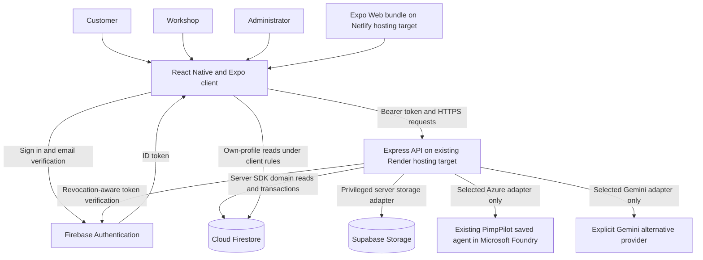
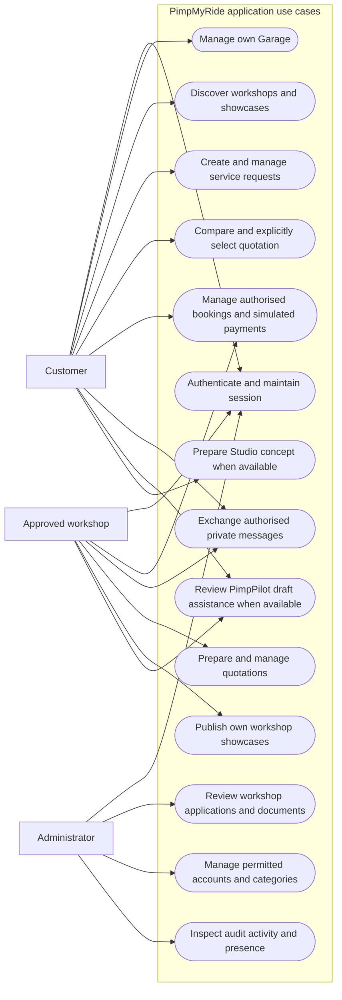
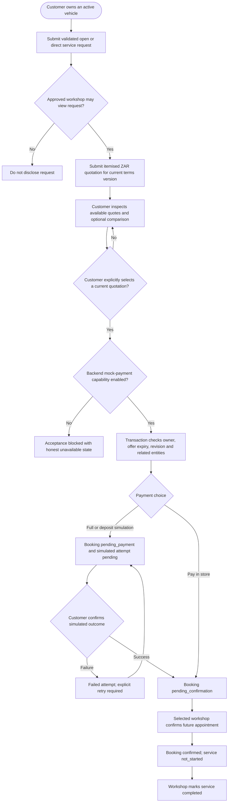
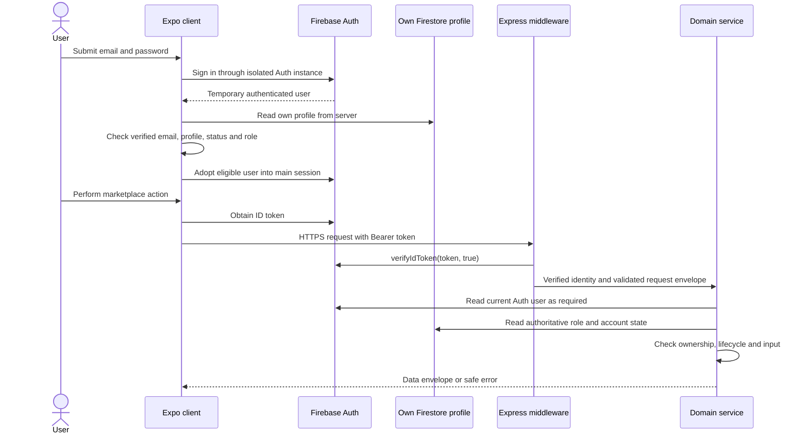
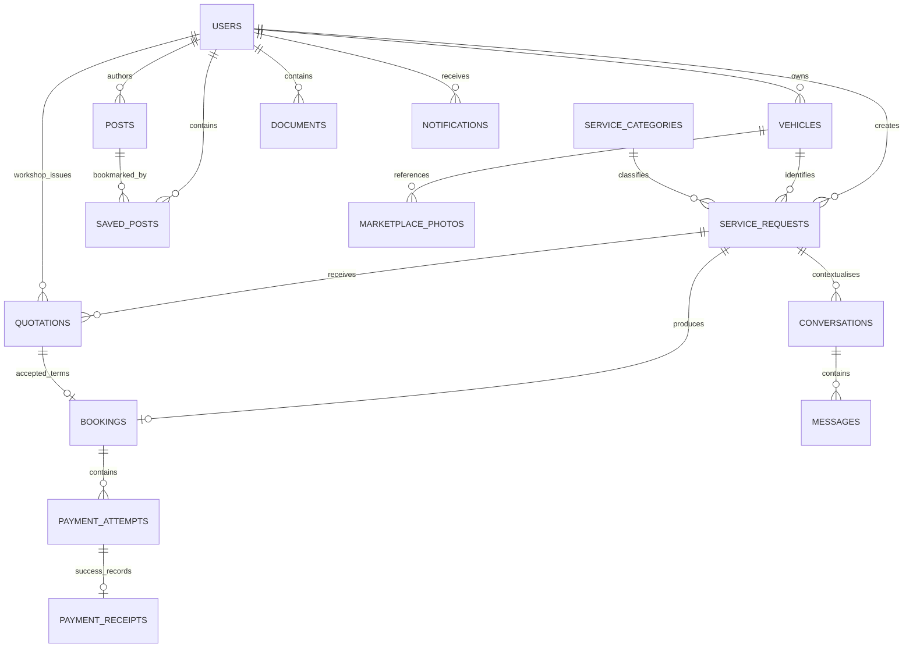
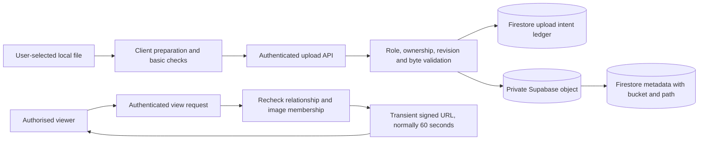
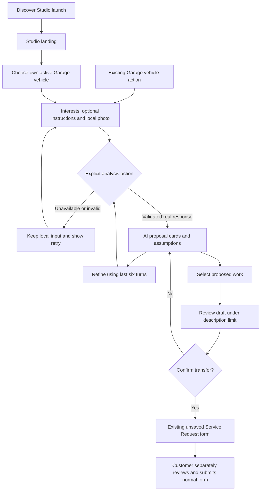

# PimpMyRide: system diagrams

**Module:** DSW02B1, University of Johannesburg. **Evidence cut-off:** 27 October 2026. **Repository baseline:** `lesley`, commit `0d7b95f`. These diagrams describe inspected implementation, not proof that every hosted integration works. Mermaid source must be rendered before Word/PDF submission. Relationships are application-enforced references, not SQL foreign keys.

## Figure D1. High-level system architecture



Azure and Gemini are alternative selections, not a fallback chain. Client rules additionally permit narrow published-post/bookmark operations; the current posts client primarily uses the authenticated API. The backend does not store uploads on Render disk. Netlify and Render are verified configuration targets; current deployed commit and end-to-end operation require separate confirmation. Sources: `backend/server.cjs`, `backend/services.cjs`, `backend/ai-provider-selection.cjs`, `src/shared/services/firebase.js`, `firestore.rules`, `render.yaml`, `.netlify/netlify.toml`.

## Figure D2. Actor and use-case model

Mermaid flowchart notation approximates a UML use-case diagram; actors and system responsibilities are explicit, but this is not a claim of native UML notation support.



Pending workshops use the Account/onboarding state rather than the approved marketplace navigator. Admin accounts cannot self-register. Sources: `src/navigation/AppNavigator.js`, `src/navigation/landingRoute.js`, the three role navigators, `backend/services.cjs` and `backend/marketplace.cjs`.

## Figure D3. Service Request → Quotation → Booking activity



Payment, appointment and service states are separate. Pay in store starts as due, not paid. Cancellation and payment-balance actions exist but are omitted here for legibility; they are documented in the API reference. One booking ID is derived from the service-request ID. Sources: `backend/marketplace.cjs`, `backend/booking-domain.cjs`, `backend/mock-payment-gate.cjs`.

## Figure D4. Authentication and API request sequence



Registration differs: `/api/profile` permits an authenticated unverified registrant to complete onboarding, but only `owner` or `shop` roles. A verified main session is still required for marketplace access. Sources: `src/features/auth/services/accounts.js`, `src/shared/services/api.js`, `backend/app.cjs`, `backend/services.cjs`.

## Figure D5. PimpPilot request and response sequence

```mermaid
sequenceDiagram
    actor U as Customer or approved workshop
    participant UI as PimpPilot interface
    participant API as Express AI service
    participant DB as Firestore
    participant AD as Selected provider adapter
    participant AZ as Existing Foundry saved agent
    U->>UI: Explicitly request draft assistance or Studio plan
    UI->>API: Firebase-authenticated bounded input
    API->>DB: Check account, categories or owned vehicle
    API->>API: Validate input, enabled state and concurrency lease
    alt Azure selected and enabled
        API->>AD: Static mode guidance and separate untrusted input
        AD->>AZ: Agent-bound Responses with store false and tools disabled
        AZ-->>AD: Provider output or compatibility error
        AD-->>API: Parsed response or sanitised failure
        API->>API: Validate successful output and drafting grounding
        API->>DB: Recheck relevant access and facts on success
        API-->>UI: Validated suggestion or error
    else Disabled service
        API-->>UI: Unavailable; no successful output fabricated
    end
    UI-->>U: Review, refine, dismiss or explicitly apply
```

The successful Azure return path is implemented/mock-tested, not live-certified. Explicit Gemini selection uses its own adapter; an Azure failure does not invoke it. Draft assistance is text-only. Only Studio accepts inline validated JPEG input. Sources: `backend/ai-assist.cjs`, `backend/ai-studio.cjs`, `backend/ai-azure-provider.cjs`, `backend/ai-provider-selection.cjs`.

## Figure D6. Conceptual Firestore entity relationships



USERS combines customer, shop and admin profiles; a workshop is not a separate `workshops` collection. `PAYMENT_ATTEMPTS`, `SAVED_POSTS`, `DOCUMENTS` and `MESSAGES` are nested collection concepts. Auxiliary heads, upload ledgers and operation receipts are omitted from this conceptual diagram and listed in the database reference. Snapshot copies are intentional denormalisation. Sources: `backend/services.cjs`, `backend/marketplace.cjs`, `backend/posts.cjs`, `backend/messaging.cjs`, `backend/documents.cjs`, `backend/photos.cjs`.

## Figure D7. Private-media data flow



New signed URLs are not persisted as media identity. Legacy public-post references are compatibility paths, not a reason to make new buckets public. Sources: `backend/storage.cjs`, `backend/photos.cjs`, `backend/posts.cjs`, `backend/profile-photos.cjs`.

## Figure D8. Studio customer activity and trust boundary



The selected original photo is displayed without edits; AI image editing is unavailable. No automatic marketplace submission is hidden in analysis or transfer. Sources: `src/features/marketplace/screens/PimpPilotStudioScreen.js`, `src/features/marketplace/components/StudioUI.js`, `src/features/marketplace/services/pimpPilotStudio.js`, `src/features/marketplace/screens/OwnerMarketplaceScreens.js`.

## Diagram review and export checklist

Render each fenced block with a Mermaid-capable editor. Check actor labels, arrow direction, wrapping and grayscale legibility. Export diagrams as SVG or high-resolution PNG for Word, then assign captions using Word's caption feature. Preserve these text sources as Appendix B. Diagrams deliberately exclude credentials, project-specific endpoints, personal records and live signed URLs. No renderer package was installed and no rendered-image validation was performed during this documentation-only task.
